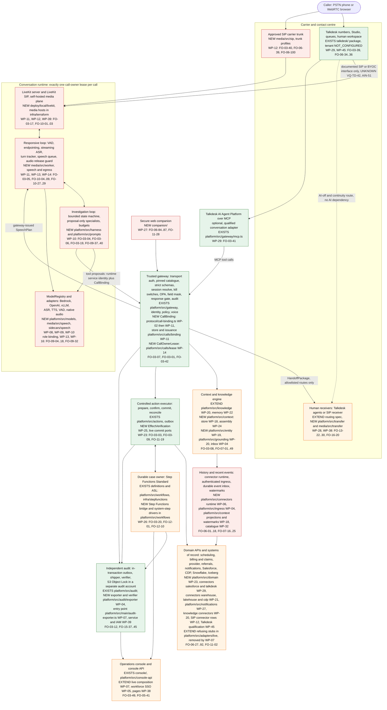
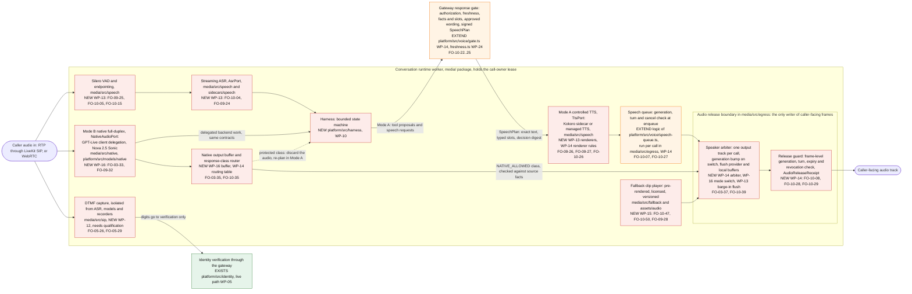
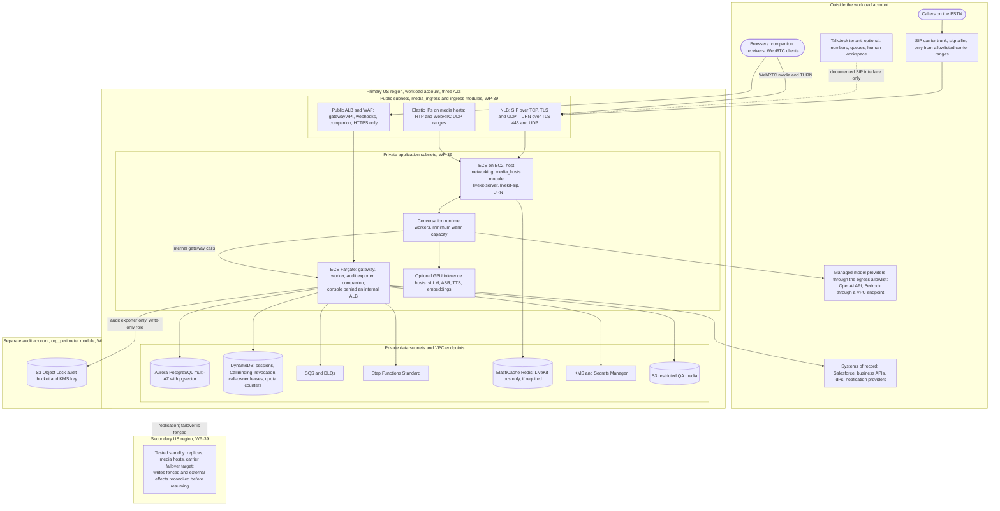
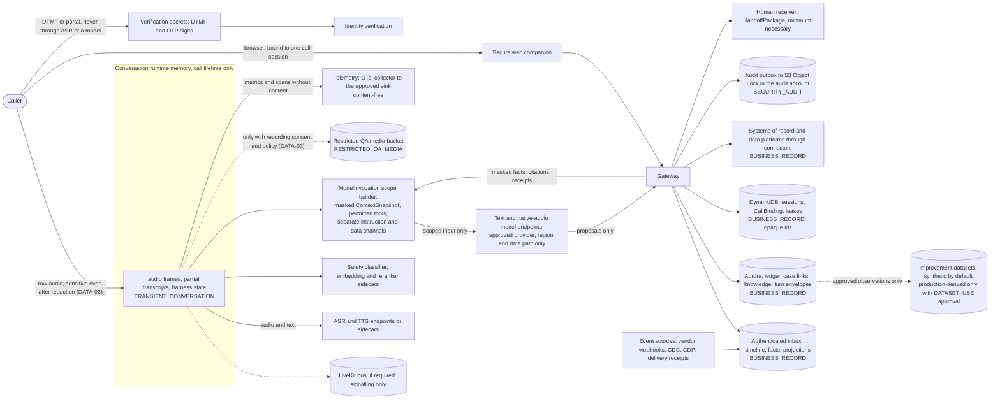
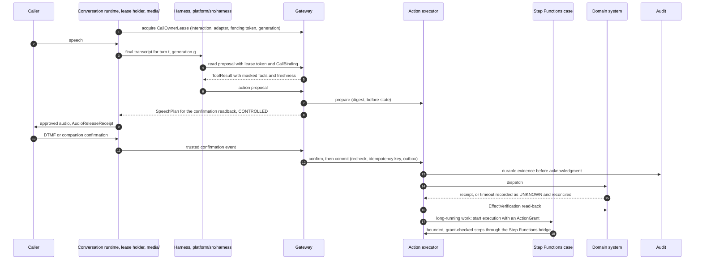

# Architecture and engineering conventions

Status: **IMPLEMENTED_OFFLINE** scope only. Nothing here has been verified against a
vendor sandbox, a real telephone path or production. See `docs/IMPLEMENTATION_STATUS.md`.

## 1. System boundary

```
 PSTN caller ──► Talkdesk (numbers, Studio routing, queues, human legs)   ◄── independent human route (no AI/gateway dependency)
                   │  Studio deterministic steps (consent, DTMF capture, auth-gate fetch, confirmation capture)
                   │        └──► Telephony-control API  (service identity: telephony_control)
                   │  Autopilot Agentic / AI Agent Platform (untrusted conversational layer)
                   │        └──► MCP Streamable HTTP adapter (service identity: mcp_tools)
                   ▼
           ┌──────────────── AWS control plane (this repository) ─────────────────┐
           │ gateway (Fastify, ECS Fargate)                                       │
           │   transport auth → pinned catalogue → strict schema → session        │
           │   resolve (server-side) → kill switch/admission → OPA decision →     │
           │   business operation → output schema → field mask → audit → result  │
           │ identity  (DynamoDB sessions, secure-link/OIDC, OTP, assertions)      │
           │ actions   (Aurora ledger: prepare/confirm/commit/reconcile, outbox)   │
           │ audit     (in-tx durable outbox → S3 Object Lock in audit account)    │
           │ workflows (definitions → local executor | Step Functions Standard)   │
           │ knowledge (approved corpus, FTS + pgvector, permission-filtered)      │
           │ console API + React console (workforce SSO, RBAC, audited actions)    │
           └──────────────────────────────────────────────────────────────────────┘
                   │                     │                    │
             Salesforce Service     Scheduling / billing /   Client & provider IdPs (OIDC),
             Cloud (system of       claims / provider APIs   notification providers
             record for Cases)
```

The caller and everything the caller says are untrusted. So are retrieved
articles, tool-returned free text, transcripts and uploaded files. Talkdesk is a
trusted *service identity* plus an independently established call binding; it
holds no business-system credentials. The gateway reconstructs permissions from
server-side state on every request.

## 2. Repository layout

| Path | Responsibility |
|---|---|
| `platform/src/protocol` | Strict zod schemas for every protocol artifact; exported to `schemas/protocol/*.schema.json` |
| `platform/src/shared` | Clock, opaque ids, canonical JSON + digests, typed errors |
| `platform/src/db` | Database port; PGlite (offline, real PostgreSQL in WASM) and `pg` (Aurora) adapters; migrator |
| `platform/migrations` | Ordered SQL migrations incl. row-level security |
| `platform/src/observability` | Content-free logger, metrics with label allowlists, tracing helpers |
| `platform/src/config` | Typed configuration, production guard (OPS-04), approval-record loader |
| `platform/src/resilience` | Timeouts, bounded retry with jitter, circuit breaker, bulkhead |
| `platform/src/ops` | Kill switches, budgets, admission control |
| `platform/src/policy` + `/policy` | OPA Rego bundle, golden decision tests, WASM evaluation engine |
| `platform/src/identity` | KV store (DynamoDB + memory), sessions, verification, assertions, auth gate |
| `platform/src/actions`, `platform/src/outbox` | Action ledger, idempotency, commit protocol, reconciliation, transactional outbox |
| `platform/src/audit` | Audit writer, hash chain, health, shipper, sinks, integrity verification |
| `platform/src/adapters` | Vendor/business ports, LOCAL fixtures with fault injection, documented live adapters |
| `platform/src/workflows` | Workflow definitions, local durable executor, ASL generator, human tasks, transfer state machine |
| `platform/src/safety`, `platform/src/voice` | Safety signals + deterministic routing; templates, response gate, turn tracking, conversation guard |
| `platform/src/knowledge`, `platform/src/memory`, `platform/src/retention` | Knowledge ingestion/retrieval, provenance-labelled memory, retention/deletion jobs |
| `platform/src/business` | Resolution contracts and business services per workflow |
| `platform/src/gateway` | Tool pipeline, tool modules, MCP adapter, telephony-control and portal endpoints |
| `platform/src/console-api` | Console backend (workforce SSO, RBAC, audited admin actions) |
| `platform/src/evaluation` | Scenario runner, scorecard, release manifest builder |
| `platform/src/demo`, `platform/src/main` | Local demo journeys and local start command |
| `platform/src/fixtures` | SYNTHETIC world shared by all local adapters and tests |
| `console/` | React + TypeScript operations console |
| `scenarios/` | Scenario corpus (development and held-out acceptance splits) |
| `infra/terraform` | Terraform modules and per-environment stacks (plan only) |
| `talkdesk/` | Talkdesk Studio / AI Agent configuration specs and operator runbooks |
| `approvals/` | Human approval records (none exist; the coding agent cannot create them) |
| `docs/` | Status, prerequisites, decisions, traceability, evidence, runbooks |

## 3. Engineering conventions (binding for all modules)

1. **Strict schemas.** Every external input is parsed with a strict zod schema
   (`z.strictObject`), bounded in size, with enums for closed sets. Unknown fields fail.
2. **Opaque identifiers only.** `newId(prefix)`; never embed PHI in ids, workflow names,
   URLs, metric labels, log fields, alert text, resource names, trace baggage or errors.
3. **No PHI in logs.** Use `platform/src/observability` loggers only; `console.log` is
   lint-banned outside CLI/demo entry points. Error messages carry reason codes only.
4. **Fail closed.** Missing session, expired session, policy error, audit unavailability,
   unknown tool version or unexpected response field ⇒ deny / safe route. Never "best effort".
5. **Server-established identity.** Nothing in a tool argument can set actor, role,
   subject, organization, assurance, consent or scopes (AUTH-03).
6. **Fixtures are labelled.** Every adapter/store has `kind: "local_fixture" | "live"`.
   Fixture data comes from `platform/src/fixtures/synthetic-world.ts` and is marked
   SYNTHETIC. Production config rejects fixtures (OPS-04).
7. **Injectable time.** Use `Clock` (`FakeClock` in tests). No `Date.now()` in domain logic.
8. **Database access** goes through the `Db` port; runtime transactions use role
   `app_runtime` (RLS enforced) and set `rls.tenantId`. `owner` role is for migrations/fixtures.
9. **Migrations** are append-only files `NNNN_name.sql`, numbered by module range:
   0001 foundation · 01xx actions/outbox · 02xx audit · 03xx support records · 04xx workflows ·
   05xx knowledge · 06xx ops (kill switches, budgets, safety events) · 07xx memory ·
   08xx retention · 09xx console. A changed applied migration fails startup.
10. **Tests** live beside code as `*.test.ts` (vitest). Test titles carry requirement tags,
    e.g. `it("[AUTH-04] expired session fails closed before TTL cleanup", ...)`. The
    traceability generator scans these tags. Mocks/fixtures are named `*Fixture*` or live in
    `fixtures/` and are explicitly labelled in test names when relevant.
11. **No new dependencies** without recording version + license in `docs/INVENTORY.md`.
12. **Caller-facing text** comes only from approved templates with typed slots
    (`platform/src/voice`). Dependency free text is never spoken.
13. **Money** is integer minor units; times are ISO-8601 UTC strings with an explicit time zone
    field for presentation.

## 4. Request flow (tool call)

1. Transport authenticates the integration (OAuth2 client credentials in live; labelled
   local fixture tokens offline) → `IntegrationIdentity` with channel `mcp_tools`.
2. Tool name + version must exist in the pinned catalogue (digest pinned in ReleaseManifest).
3. Arguments validated against the tool's strict schema and byte bound.
4. Session reference taken from the trusted transport binding (see TB-01) and resolved to
   `AuthContext` from DynamoDB with expiry/revocation/generation/integration checks.
5. Kill switches and admission (budget, capacity) — safety and human-route tools are exempt.
6. Resource described from authoritative lookups; relationship facts from authoritative
   enrollment/delegation registries; OPA decision (deny by default).
7. Business operation with timeout, circuit breaker and bounded retries (no retry stacking).
8. Output validated against the tool's output schema (unexpected fields rejected); field mask
   from the policy decision applied.
9. Audit: a consequential action's evidence is appended in its commit transaction, and a
   disclosure (`AUDIT_READ`) is returned only after its `tool.invoke` event is durably appended.
   Any other failed `tool.invoke` append does not withhold the result; it is logged and counted
   (`vsp_protected_actions_total{audit="not_recorded"}` for accepted consequential calls), and
   handoff route evidence written during an audit outage is deferred and appended later in order
   ([ADR-0011](adr/ADR-0011-deferred-route-audit.md)).
10. `ToolResult` tagged with `turnId` + `sessionGeneration`; speech only as a `SpeechDirective`
    rendered by the response gate before any audio.

## 5. Unresolved trust-boundary capabilities (flagged)

| ID | Capability | Status | Consequence if unavailable |
|---|---|---|---|
| TB-01 | Talkdesk can pass the opaque session reference to MCP tools outside model-controlled arguments (header/context mapping) | UNKNOWN | Protected tools use `server_to_server_lookup` (verified interaction lookup) or stay BLOCKED; argument-supplied refs require an approved exception |
| TB-02 | Deterministic Studio/Skill step can capture confirmation (DTMF/affirmative) and call the telephony-control API | UNKNOWN | Consequential commits stay disabled for autonomous flow; human agent confirms |
| TB-03 | Isolated DTMF capture where digits reach neither ASR, model, recording nor transcript | UNKNOWN | OTP fallback disabled; secure link / portal / human verification only |
| TB-04 | Every protected utterance can be validated before audio emission | UNKNOWN | Protected classes use deterministic rendering path only; else the fallback speech runtime (ADR-0006) |
| TB-05 | Early safety signal available before guardrail refusal/termination, with deterministic handoff | UNKNOWN | Autonomous flow does not launch (spec section 2) |
| TB-06 | Auth Gate variable can be cleared on expiry and cannot be mutated by the model | UNKNOWN | Gate treated as UX only; gateway enforcement is authoritative regardless |
| TB-07 | Transfer events (receiver accepted, bridged, caller connected) exported to the gateway | UNKNOWN | Transfer success cannot be recorded; outcome stays OUTCOME_UNKNOWN and humans reconcile |
| TB-08 | Version identity of agent/model/voice/prompt in event exports | UNKNOWN | ReleaseManifest cannot bind vendor configuration; release BLOCKED |
| TB-09 | Webhook authentication mechanism documented by Talkdesk for event delivery | UNKNOWN | Webhook ingestion disabled; no invented signature protocol |
| TB-10 | Contracted concurrency / quotas for AI sessions, ASR/TTS, tools | UNKNOWN | Capacity gates BLOCKED |

## 6. Target architecture (follow-on programme)

Status: **target design, not an implementation claim.** This section maps the follow-on prompt
(`docs/spec/voice-support-followon-specification.txt`, sections 3, 9, 10, 12 and 16) onto this
repository. Sections 1 to 5 above describe the code as it stands. They remain the design of the
existing modules and of the optional Talkdesk-native conversation adapter. The decisions behind
this section are in [ADR-0018](adr/ADR-0018-followon-product-architecture.md). The threats of the new
components are in `docs/security/threat-model.md` section 8 (FT-01 onwards) and their data flows in
`docs/privacy/data-flow-inventory.md` (DF-27 onwards).

### 6.0 Legend and status rules

| Mark | Meaning |
|---|---|
| **EXISTS** | Code is present and is reused as it is. Its software status is whatever its evidence shows. Most EXISTS elements are tested only on PGlite and LOCAL FIXTURE adapters. PGlite is a single connection, so those tests never verify a driver, pooling or multi-connection concurrency ([ADR-0018](adr/ADR-0018-followon-product-architecture.md) decision 7.2), and none of it is production evidence. |
| **EXTEND** | Code is present, but the production path is incomplete: a fixture-only adapter, a refusing live stub, no live composition, or a missing contract field. |
| **NEW** | No code exists yet. |

Tags. Each element names the work package that owns its files (`WP-NN`, from
`docs/followon/work-packages.yaml`, which is generated from `docs/followon/source/packages.yaml`), followed by its follow-on requirement ids (`FO-<section>-<n>`,
from `docs/followon/requirements.yaml`). When several packages build one element they are listed in
dependency order. `FO-10-04..09` means the range of ids. A tag says who builds the element, not how far
it has got; the status of each requirement is in `docs/followon/gap-ledger.yaml`. External inputs are
named by their activation register id (`AIN-NN`, `docs/followon/activation-register.yaml`).

Status axes (prompt section 0; [ADR-0018](adr/ADR-0018-followon-product-architecture.md) decision 7):
software `MISSING` / `IMPLEMENTED` / `VERIFIED_LOCAL` / `RELEASE_PACKAGE_VERIFIED`; environment
`NOT_CONFIGURED` / `CONFIGURED` / `VERIFIED_SANDBOX` / `APPROVED_PILOT` / `VERIFIED_PRODUCTION`;
qualification `NOT_RUN` / `FAIL` / `INCONCLUSIVE` / `PASS`. For a production capability, an interface
plus a mock, a fixture-only adapter, a refusal in non-local composition, canned success, TEST ids, an
empty history or a log line counts as `MISSING`, even when a local fixture test passes (prompt sections 6
and 21).

The one blocker that runs through every diagram below: `platform/src/main/container.ts:308-313` refuses
every non-local composition (`LIVE_COMPOSITION_NOT_IMPLEMENTED`), and `platform/src/adapters/live/blocked-set.ts`
fills every business and Talkdesk slot with a refusing stub. Until the live composition root exists
(WP-07: `platform/src/main/live-container.ts` and `live-modules.ts`; FO-16-11, FO-19-06; the product-level
FO-00-01 closes in WP-43), every
element marked EXISTS can be reached only from the local/ci composition.

### 6.1 Reference architecture mapped to modules

Prompt section 3: one conversational owner, one durable case owner and one controlled action executor.
Specialists may investigate in parallel, but they cannot speak, reassign the case or commit.



| Section 3 element | Concrete module or process | Mark | Work package | Requirement ids | Evidence today |
|---|---|---|---|---|---|
| One conversational owner | `CallOwnerLease` (DynamoDB conditional record with a fencing token) in `platform/src/calls/lease`, checked by the gateway on every tool call and by the release guard in `media/src/egress` before every emission | NEW | WP-14 | FO-03-01, FO-03-42, FO-10-42 | `platform/src/gateway/call-state.ts` holds only the AI-capacity `SessionLeaseRegistry`, not adapter ownership |
| One durable case owner | Step Functions Standard in deployed environments, through the Step Functions bridge in `platform/src/workflows`; `PgWorkflowEngine` in local/ci only | EXTEND | WP-26 | FO-03-02, FO-03-20, FO-12-01, FO-12-24 | `platform/src/workflows/engine.ts:367`; the bridge is not implemented (`platform/src/workflows/README.md:329`) |
| One controlled action executor | `ActionService` (`platform/src/actions`) with the transactional outbox (`platform/src/outbox`) | EXISTS (tested on PGlite only); EXTEND with live commit ports, EffectVerification and an import rule that keeps write ports inside `platform/src/actions` | WP-25 (executor and EffectVerification), WP-23 and WP-29 (live commit ports), WP-06 (import rule), WP-04 (contention tests on `postgres:16`) | FO-03-03, FO-03-09, FO-11-02, FO-11-19 | `platform/src/actions/action-service.property.test.ts`; live commit slots refuse (`platform/src/adapters/live/business-systems-blocked.ts`) |
| Specialists in parallel | Harness fan-out with a bounded count; each specialist returns `{evidenceRefs, proposals}` only | NEW | WP-10 | FO-03-04, FO-09-39 | none |
| Caller, Talkdesk or SIP carrier, media runtime | LiveKit server and LiveKit SIP (`deploy/local/livekit`, `media/src/sip`); Talkdesk reaches it only through a documented, qualified SIP interface | NEW | WP-11, WP-12, WP-29 (Talkdesk side), WP-39 (hosts) | FO-03-17, FO-03-40, FO-03-43, FO-06-39 | no media code; `platform/package.json` has no LiveKit dependency |
| Responsive loop | `media/` worker on the LiveKit Node SDK: `media/src/worker`, `lifecycle`, `codecs` and `binding` (WP-11), `speech` (WP-13), `egress` (WP-14) | NEW | WP-11, WP-12 (SIP media), WP-13, WP-14 | FO-03-05, FO-10-01..09 | `platform/src/voice/speech-queue.ts` and `turns.ts` are in-process LOCAL FIXTURES |
| Investigation loop | `platform/src/harness` with `platform/src/prompts` | NEW | WP-10 (WP-08 and WP-25 for the model-call and action rows of the range) | FO-03-06, FO-03-19, FO-09-37..46 | none; the only driver is the rule-based LOCAL SIMULATED COORDINATOR (`platform/src/evaluation/driver/labels.ts:10`) |
| Trusted gateway, identity and OPA | `platform/src/gateway`, `platform/src/identity`, `platform/src/policy` | EXISTS | WP-05 (live identity), WP-14 (pipeline and session binding), WP-07 (live composition), WP-10 (re-run through the harness) | FO-03-07, FO-03-27 | `platform/src/gateway/pipeline.test.ts`; Rego tests under `policy/vsp` |
| Context and knowledge engine | `platform/src/knowledge` and `platform/src/memory`, plus NEW `platform/src/context` (timeline, facts, projections, watermarks; assembly), `platform/src/entity` and `platform/src/grounding` | EXTEND and NEW | WP-18, WP-19, WP-20, WP-22, WP-24, WP-04 (inbox) | FO-03-08, FO-07-01..49, FO-08-11..15 | the local composition runs knowledge search as full text only (no embedder) |
| Action executor over domain APIs | `platform/src/actions` plus live adapters in `platform/src/domain` and the vendor connectors, all built on the connector runtime | EXTEND | WP-23, WP-25, WP-29 | FO-03-09, FO-06-72..75, FO-11-32 | every live business slot is a refusing stub |
| History and recent events | Connector runtime (`platform/src/connectors/runtime`, `profile`, `http`, `secrets`, `dsl`), authenticated ingress and inbox (`platform/src/ingress`), projections and watermarks (`platform/src/context`) | NEW | WP-06, WP-04, WP-18, WP-32 (catalogue conformance) | FO-06-01..18, FO-07-16..25, FO-06-97 | none |
| Independent audit and operations console | `platform/src/audit` plus the exporter and separate verifier in `platform/src/audit/exporter` with signed manifests, run from `platform/src/main/audit-exporter.ts` as a separately deployed service; `console/` and `platform/src/console-api` | EXISTS and EXTEND | WP-04 (exporter, verifier, manifests), WP-07 (entry point, console composition), WP-39 (separate services and IAM, `infra/terraform/modules/console_service`), WP-38 (console pages) | FO-03-10, FO-03-12, FO-03-49, FO-15-45 | S3 sink tested with a stub client (`platform/src/audit/sinks/s3-object-lock.test.ts`); console is local/ci only (`platform/src/main/console.ts:1-8`) |
| Models receive only scoped data and tool proposals | `ModelInvocation` built from a policy-masked `ContextSnapshot`; model output is a proposal to the gateway, never a fact of record | NEW | WP-02 (contracts), WP-10 (harness), WP-24 (snapshot) | FO-03-13, FO-09-42, FO-04-13, FO-04-14 | field masks exist (`platform/src/gateway/mask.ts`); no model path exists |
| Live composition | `platform/src/main/live-container.ts` and `platform/src/main/live-modules.ts`, selected by configuration, same image in every environment | NEW | WP-07, then the integration package of each phase (WP-17, WP-25, WP-30, WP-38); WP-41 deploy, WP-43 closure | FO-00-01, FO-16-11, FO-16-25, FO-19-06 | `platform/src/main/container.ts:308-313` refuses |

Only one conversation adapter owns a call (FO-03-42). When the Talkdesk AI Agent Platform adapter owns
it, the LiveKit runtime does not join the call, and the trust-boundary flags in section 5 apply unchanged.
When the LiveKit runtime owns it, Talkdesk is at most the carrier and the human route.

### 6.2 Voice modes and the audio release boundary

Both modes are implemented and testable (prompt section 3). Mode A, the controlled cascade, is the default
route for protected facts, confirmations, disclosures, safety and error responses. Mode B, native
full-duplex, is used for natural conversation and delegated backend work, under the same authority and
outcome contracts. The runtime decides which audio may reach the caller. A prompt does not.



Release rules (enforced in code, each with an audio test in `make test-audio`, which WP-17 delivers):

1. **No plan, no audio.** In Mode A, no frame reaches the caller unless the release guard has accepted a
   gateway-issued `SpeechPlan` (contract FO-04-31, WP-02; issued and checked by WP-14) or the frame
   belongs to a fallback clip listed in the signed clip manifest (WP-15). A plan carries the utterance
   class, exact text or bounded paraphrase, typed protected slots, source and receipt refs, policy, auth
   and context versions, session generation, turn, expiry and the output-decision digest (FO-10-22). The
   runtime verifies the digest before TTS and again before emission.
2. **Response-class routing table.** This is runtime configuration, not prompt text (FO-03-35, WP-14).
   Defaults:

   | Response class (`platform/src/protocol/tools.ts:85`) | Default route | Condition to change |
   |---|---|---|
   | `IDENTITY`, `FINANCIAL_FACT`, `COMMITMENT`, `PROTECTED_FACT` | CONTROLLED, with deterministic trusted slots | none; protected classes never use native speech |
   | `SAFETY`, `CLINICAL_BOUNDARY`, `RECORDING_DISCLOSURE` | CONTROLLED, fixed approved wording; fallback clip if TTS fails | none |
   | `LOW_RISK_GROUNDED` | CONTROLLED | NATIVE_ALLOWED only after the bounded-paraphrase validator (FO-10-32, WP-14) and native qualification (FO-03-38, WP-16) pass |
   | `GENERIC_STATUS` | CONTROLLED | NATIVE_ALLOWED only after native qualification (FO-03-38, WP-16); "checking" only while a tool request is actually in flight (FO-10-21, WP-14) |

3. **Scoped native context.** A native speaker session is opened with a context scope that holds no
   protected facts (FO-03-36, WP-16). A protected request from the native model goes to the backend
   through client delegation, and the answer is spoken by Mode A.
4. **Switching and interruption.** There is one active output track per call. A speaker switch or a
   barge-in increments the turn revision, invalidates pending speech and ambiguous confirmations, and
   flushes both the provider buffer and the local playback buffer before the next speaker starts
   (FO-03-37 WP-16, FO-10-38 WP-14, FO-10-39 WP-13). Cancelling speech never cancels a dispatched action.
   The action is reconciled instead (`platform/src/actions/action-service.ts` `invalidatePending`, EXISTS).
5. **Failure audio.** Model, ASR, TTS or judge failure plays a pre-rendered clip (WP-15). A generative model
   never writes its own last-resort safety or error instruction, and a failed safety response is never
   silence (FO-10-47, FO-10-48, FO-10-50, SAFE-03).
6. **Evidence.** Actual audio, the model transcript and the independent ASR transcript are kept as separate
   evidence, under `RESTRICTED_QA_MEDIA` rules (FO-10-37, WP-17).

The five pre-emission checks (prompt section 10) and where each one runs:

| Check | Enforced in | Today | Mark, work package, requirement ids |
|---|---|---|---|
| 1. Authorization and source freshness | Gateway gate at plan time; the release guard re-checks revocation and expiry at emission (AUTH-04) | Authorization in `platform/src/voice/gate.ts` step 5; no freshness check; no emission point exists to re-check at | EXTEND WP-14 FO-10-23; NEW WP-24 FO-10-24 (`platform/src/voice/freshness.ts`) |
| 2. Facts, amounts, dates, outcome language, scope, wording | Gateway gate and `platform/src/voice/slots.ts` | Implemented, gateway pipeline only | EXISTS, re-run by WP-14, FO-10-25 |
| 3. Permitted render path | `TtsPort` allowed renderers per response class | none | NEW WP-13 (renderers), WP-14 (rules), FO-10-26 |
| 4. Generation, turn and cancellation at enqueue and at emission | Speech queue (enqueue) and release guard (each frame), both in `media/src/egress` | Queue checks exist as a LOCAL FIXTURE, not composed | EXTEND WP-14 FO-10-27 |
| 5. Approved content and audio digest, actual playback status | `AudioReleaseReceipt` written by the release guard | `ResponseRecord` has no audio digest or playback status | NEW WP-14 FO-10-28; contract WP-02 FO-04-32 |

With the Talkdesk-native adapter, the vendor owns ASR, TTS and the release point, and TB-04 is still
UNKNOWN (section 5). Protected classes on that adapter therefore use deterministic Studio rendering
or are not spoken; the ADR-0006 fail-closed rule stays in force for that adapter only.

### 6.3 Deployment topology

#### 6.3.1 Deployable units

Media, API/control plane, asynchronous workers and the audit exporter are deployed separately where their
scaling or trust boundaries differ (FO-03-12). This is not a microservice per module. Images are built by
WP-40; the AWS services, IAM and networking are WP-39.

| Unit | Contains | Why separate | Local composition | AWS reference | Mark, work package, requirement ids |
|---|---|---|---|---|---|
| gateway | `platform/src/main/server.ts`: tool pipeline, MCP adapter, telephony, webhook and portal routes | public API, request scaling | container | ECS Fargate behind the public ALB and WAF | EXISTS image definition, never built (`platform/Dockerfile:10`); EXTEND live composition WP-07 FO-16-11 |
| worker | outbox dispatch and consume, reconcile, expiry, retention, Step Functions bridge consumer | asynchronous scaling, no ingress | container | ECS Fargate, no load balancer | EXISTS (`platform/src/worker/loops.ts`); NEW bridge WP-26 FO-12-01 |
| audit exporter | audit shipper, exporter and verifier (`platform/src/audit/exporter`), entry point `platform/src/main/audit-exporter.ts`, write-only role into the audit account | trust boundary: own IAM role and own key grant | container (`deploy/local/services/app.compose.yaml`) | ECS Fargate task with a cross-account write-only role | EXTEND (today a worker loop): exporter and separate verifier identity WP-04 FO-15-40, entry point WP-07, separate service and IAM WP-39 FO-03-12 |
| console | console API and the React console | workforce trust boundary | container | ECS Fargate behind an internal ALB and WAF, workforce SSO (`infra/terraform/modules/console_service`) | EXTEND WP-07 FO-03-49, WP-05 FO-14-02, WP-38 pages, WP-39 service |
| companion | caller-facing secure web app (authentication, review, asynchronous replies) in `companion/` | different audience and origin | container | Fargate behind the public ALB | NEW WP-27 FO-06-84..87 |
| media plane | `livekit-server`, `livekit-sip`, TURN, and Redis as the LiveKit bus only if the pinned version needs it | UDP, RTP and host networking | containers (`deploy/local/services/core.compose.yaml` WP-03, configuration in `deploy/local/livekit` WP-11) | ECS on EC2 with host networking, Elastic IPs, NLB for SIP and TURN (`infra/terraform/modules/media_hosts` and `media_ingress`); ElastiCache for the bus | NEW WP-39 FO-03-46, FO-03-47, FO-16-34 |
| conversation runtime | `media/` worker: LiveKit agent, harness, model adapters, release guard | per-call scaling, latency, holds model credentials | container, two replicas for chaos tests | ECS on EC2 or Fargate in the media AZs, minimum warm capacity | NEW WP-11 to WP-17 FO-03-05; capacity WP-39 FO-16-29 |
| inference sidecars (optional) | ASR (whisper-large-v3-turbo) and TTS (Kokoro-82M) in `sidecars/speech` (WP-13), embeddings (bge-m3) and reranker (bge-reranker-v2-m3) in `sidecars/retrieval` (WP-20), safety auxiliary in `sidecars/safety` (WP-15), vLLM | GPU or CPU inference; Python is allowed here only (prompt section 3) | CPU containers (this environment has no GPU) | EC2 GPU instances in private subnets (WP-39) | NEW WP-08 FO-09-08, WP-13 FO-09-24..26, WP-20 FO-09-23 |

#### 6.3.2 Local Docker composition (Layer-2 integration environment)

`deploy/local/compose.yaml` (WP-03) is the entry file. The runner (`Makefile` and `scripts/vsp/runner.mts`,
WP-03) loads every `deploy/local/services/*.compose.yaml` fragment, so each package adds the services it
needs without editing the entry file (FO-16-01, FO-16-13..23). It runs the production adapters over their
real protocols against emulators. Emulated behaviour is labelled in every test report. Images are pinned
by digest and recorded in `docs/INVENTORY.md`. Safe defaults never call a billable endpoint (OPS-05).
Docker must be started in this environment (`docs/followon/CONTINUATION.md`). Acceptance commands select
fragments with `make up PROFILE=...` (profiles named in the plan: `core`, `media`, `sip`, `speech`,
`models`, `domain`, `retrieval`, `lakehouse`).

| Fragment or directory | Services | Owner |
|---|---|---|
| `deploy/local/services/app.compose.yaml`, `deploy/local/services/otel-collector.compose.yaml` | the application images (gateway, worker, two media workers, audit exporter, console, companion) and an OpenTelemetry Collector with a file exporter | WP-07 |
| `deploy/local/services/core.compose.yaml` | postgres:16 with pgvector, DynamoDB Local, ElasticMQ, MinIO with Object Lock, LocalStack (KMS, Secrets Manager, SNS, SES), Keycloak, Step Functions Local, Mailpit, ClamAV, livekit-server, livekit-sip | WP-03 |
| `deploy/local/services/keycloak-realm.compose.yaml`, `deploy/local/keycloak/` | realm import with synthetic client, provider, partner and workforce users | WP-05 |
| `deploy/local/livekit/` | LiveKit server and SIP configuration | WP-11 |
| `deploy/local/services/sip-test.compose.yaml`, `deploy/local/sip/` | softphone and receiver agents (pjsua or sipp) with real SIP signalling and RTP | WP-12 |
| `deploy/local/services/model-emulator.compose.yaml` | protocol-exact OpenAI Responses and Bedrock event-stream emulators, vLLM-compatible variant | WP-08 |
| `deploy/local/services/speech.compose.yaml` | ASR and TTS sidecars | WP-13 |
| `deploy/local/services/timeline-sources.compose.yaml` | synthetic timeline and event sources | WP-18 |
| `deploy/local/services/retrieval.compose.yaml` | embedding and reranker sidecar | WP-20 |
| `deploy/local/services/lakehouse.compose.yaml`, `deploy/local/lakehouse/` | Iceberg REST catalog, MinIO, Trino or DuckDB | WP-21 |
| `deploy/local/services/reference-business-api.compose.yaml` | reference business API (`services/reference-business-api`) | WP-23 |
| `deploy/local/services/toxiproxy.compose.yaml` | network fault injection | WP-42 |
| `platform/test/emulators/` | test emulators for models (WP-08), authority registries (WP-19), data platforms (WP-21), notifications (WP-27), Talkdesk and Salesforce (WP-29); receiver client in `platform/test/receiver` (WP-28) | per directory |

```mermaid
flowchart TB
  subgraph APP["app.compose.yaml, WP-07: production code, local profile"]
    gwc["gateway"]
    wkc["worker"]
    mwc["media worker, two replicas"]
    axc["audit exporter"]
    cnc["console"]
    cpc["companion"]
  end
  subgraph CORE["core.compose.yaml, WP-03"]
    pg[("postgres:16 with pgvector, Aurora stand-in")]
    ddb[("DynamoDB Local")]
    mq["ElasticMQ, SQS API"]
    lst["LocalStack: KMS, Secrets Manager, SNS, SES"]
    minio[("MinIO with Object Lock: audit and QA media buckets")]
    sfn["Step Functions Local, task-token fidelity to record"]
    kc["Keycloak, realm from WP-05"]
    mail["Mailpit"]
    clam["ClamAV"]
    lks["livekit-server, configuration from WP-11"]
    lsip["livekit-sip"]
  end
  subgraph SIPF["sip-test.compose.yaml, WP-12"]
    ua["SIP caller agent with synthetic audio"]
    rcv["SIP receiver agent: accept, decline, drop"]
  end
  subgraph MODELS["Models and speech"]
    memu["model-emulator.compose.yaml, WP-08:<br/>OpenAI Responses, Bedrock ConverseStream, vLLM server"]
    side["speech.compose.yaml, WP-13: ASR, TTS"]
    retr["retrieval.compose.yaml, WP-20: embeddings, reranker"]
  end
  subgraph DOMAIN["Domain and source emulators"]
    ref["reference-business-api.compose.yaml, WP-23"]
    tl["timeline-sources.compose.yaml, WP-18: signed events"]
    lake["lakehouse.compose.yaml, WP-21"]
    emu["platform/test/emulators: Salesforce and Talkdesk WP-29,<br/>authority WP-19, notifications WP-27"]
  end
  tox["toxiproxy.compose.yaml, WP-42"]
  otel["otel-collector.compose.yaml, WP-07"]

  ua --> lsip --> lks
  rcv --> lsip
  mwc --> lks
  mwc --> memu
  mwc --> side
  mwc --> gwc
  gwc --> pg
  gwc --> ddb
  gwc --> lst
  gwc --> kc
  gwc --> ref
  gwc --> emu
  gwc --> retr
  gwc --> lake
  tl --> gwc
  wkc --> pg
  wkc --> mq
  wkc --> sfn
  wkc --> mail
  axc --> minio
  cnc --> pg
  cnc --> kc
  cpc --> gwc
  tox -.->|"faults between app and dependencies"| gwc
  APP --> otel
```



Emulators show protocol behaviour only. They do not show IAM and key-policy enforcement, Step Functions
quotas and history limits, Aurora failover, DynamoDB throttling, carrier and PSTN codecs and latency,
vendor webhook signing, or model quality. Those stay `NOT_RUN` until a sandbox qualification runs (Layer 5).

#### 6.3.3 AWS reference topology, including media, SIP, RTP and TURN

The existing plan (`infra/terraform/modules/ingress/main.tf:230-232`) has an application load balancer
only, and an HTTP load balancer cannot carry RTP or TURN (FO-03-47). WP-39 owns `infra/terraform/**` and
adds the `media_hosts` and `media_ingress` modules (FO-03-46, FO-16-34), separate services and IAM for the
gateway, worker, media, console (`console_service` module) and audit exporter (FO-03-12, FO-03-49a), the
`org_perimeter` module, TURN and SIP certificates, DNS and media-host spend alarms (AIN-47, AIN-48), and the
secondary-region and DR job definitions.



Networking rules for the media module:

* SIP signalling is accepted only from allowlisted carrier source ranges, with digest credentials or mutual
  TLS per connector profile (FO-06-100). The trunk profile and dispatch rules are WP-12 (`media/src/sip`);
  security groups and an OPA plan rule restricting ports and sources are WP-39.
* RTP and WebRTC media use UDP port ranges on host-networked instances that advertise their public address
  (Elastic IP). The port numbers are configuration of the pinned LiveKit version and are verified when the
  version is pinned (ADR-0018 open item 2). TURN over TLS on 443 serves restrictive client networks (WP-39).
* Certificates for SIP TLS and TURN TLS live on the media hosts or the NLB TLS listener. Expiry is
  monitored (FO-15-27, WP-39; the certificates and DNS records are AIN-47).
* Readiness checks the dependent capabilities (media node registered, SIP trunk reachable, gateway
  reachable), not only a 200 from a process (FO-16-37, WP-32).
* The continuity route works at carrier level and does not depend on application recovery: a carrier or
  Talkdesk route goes straight to staffed queues (FO-16-57, OPS-02; WP-15 for the LiveKit SIP dispatch
  rule, AIN-19 for the independent carrier route).
* Cross-region failover fences writes and reconciles external effects before resuming. The
  infrastructure part is WP-39 (FO-16-44); the application write fence, checked by the action executor
  before every commit with a reconcile-before-unfence gate and a DR chaos job, is WP-42 (FO-16-44a).

A self-hosted reference deployment without AWS managed services (PostgreSQL, LiveKit, MinIO, an OPA
bundle, an OIDC IdP) lives in `deploy/reference/` (`deploy/reference/compose.yaml`, WP-39), separate from
`infra/terraform` (FO-03-48).

### 6.4 Module dependency diagram

Arrows mean "imports"; dotted arrows are HTTP calls, not imports. The layers are a reading aid; the
enforced rules are the six listed below the diagram. The untrusted-output group (models, prompts,
harness and the `media/` package) is drawn with its complete allowlist. For every other module the edges
show its main dependencies only.

```mermaid
flowchart BT
  subgraph L0["Contracts"]
    protocol["protocol EXTEND WP-02"]
    shared["shared EXISTS, registry group"]
  end
  subgraph L1["Platform services"]
    db["db EXTEND WP-04"]
    obs["observability EXTEND WP-07"]
    res["resilience EXISTS, owned by WP-06"]
    cfg["config EXTEND WP-07, WP-31"]
    egress["egress check: privacy/egress.ts WP-08,<br/>connectors/http WP-06"]
    priv["privacy EXTEND WP-22"]
    ops["ops EXTEND, ops group: WP-07, WP-17, WP-25,<br/>WP-30, WP-38, then WP-42 and WP-43"]
  end
  subgraph L2["Trust and transport"]
    pol["policy EXTEND, policy group;<br/>input.ts WP-22 in phase D"]
    calls["calls NEW: binding WP-11, lease WP-14"]
    idn["identity EXTEND WP-04, WP-05"]
    audm["audit EXTEND WP-04"]
    obx["outbox EXTEND WP-04"]
    ingr["ingress NEW WP-04"]
    conn["connectors NEW: runtime WP-06,<br/>families WP-19, WP-20, WP-21, WP-29, catalog WP-32"]
  end
  subgraph L3["Domain engines"]
    actm["actions EXTEND WP-25"]
    adp["adapters EXTEND WP-06, WP-07"]
    domm["domain NEW WP-23"]
    know["knowledge EXTEND WP-20"]
    grnd["grounding NEW WP-20"]
    memr["memory, retention EXTEND WP-22"]
    pops["privacy-ops NEW WP-22"]
    ctxm["context NEW WP-18, WP-24"]
    ent["entity NEW WP-19"]
    saf["safety EXTEND WP-15"]
    voi["voice EXTEND WP-14"]
    notif["notifications NEW WP-27"]
    xfer["transfer NEW WP-28"]
  end
  subgraph L4["Business and durable work"]
    wf["workflows EXTEND WP-26"]
    bus["business EXTEND WP-25, WP-30"]
  end
  subgraph L5["Trusted boundaries"]
    gwm["gateway EXTEND: pipeline WP-14,<br/>gateway group"]
    capi["console-api EXTEND WP-38"]
  end
  subgraph L5B["Operator services"]
    tcfg["tenant-config NEW WP-31"]
    rdy["readiness NEW WP-32"]
    std["studio NEW WP-33"]
    mon["monitors, review NEW WP-35"]
    imp["improvement NEW WP-36, WP-37"]
    qual["qualification NEW WP-45"]
  end
  subgraph L6["Untrusted-output orchestration: allowlist only"]
    mods["models NEW WP-08, WP-09, WP-16"]
    prm["prompts NEW WP-10"]
    harm["harness NEW WP-10"]
    mediap["media/ package NEW WP-11 to WP-17,<br/>then the media group"]
  end
  gwc["gateway-client NEW WP-07: generated from the gateway OpenAPI"]
  subgraph L7["Composition and tooling"]
    mainm["main EXTEND WP-07, phase integration packages"]
    wrk["worker EXTEND WP-07"]
    evalm["evaluation EXTEND WP-01, WP-34;<br/>manifest.ts then WP-40"]
    loc["fixtures, adapters/local, demo: local and ci only"]
  end
  subgraph PKG["Other workspace packages, HTTP only"]
    cons["console/ EXISTS, console group"]
    compn["companion/ NEW WP-27"]
    rba["services/reference-business-api NEW WP-23"]
    sidec["sidecars/ NEW WP-13, WP-15, WP-20"]
  end

  db --> protocol
  db --> shared
  cfg --> protocol
  egress --> protocol
  egress --> obs
  pol --> protocol
  idn --> db
  calls --> db
  calls --> protocol
  audm --> db
  obx --> db
  ingr --> obx
  ingr --> audm
  conn --> egress
  conn --> res
  conn --> cfg
  actm --> obx
  actm --> audm
  actm --> domm
  actm --> notif
  actm --> xfer
  adp --> conn
  domm --> conn
  know --> conn
  grnd --> know
  ctxm --> conn
  ctxm --> pol
  ctxm --> ingr
  ent --> conn
  pops --> memr
  pops --> ctxm
  pops --> ent
  memr --> priv
  notif --> conn
  xfer --> ingr
  saf --> protocol
  voi --> protocol
  wf --> actm
  bus --> actm
  bus --> wf
  bus --> adp
  bus --> know
  bus --> ctxm
  gwm --> bus
  gwm --> idn
  gwm --> calls
  gwm --> pol
  gwm --> ctxm
  gwm --> grnd
  gwm --> saf
  gwm --> voi
  capi --> bus
  capi --> tcfg
  capi --> rdy
  capi --> std
  capi --> mon
  capi --> imp
  tcfg --> cfg
  tcfg --> audm
  rdy --> conn
  rdy --> tcfg
  std --> tcfg
  std --> know
  mon --> mods
  evalm --> mon
  imp --> mon
  imp --> evalm
  imp -->|"drafts and signed canary limits only"| tcfg
  qual --> rdy
  mods --> protocol
  mods --> shared
  mods --> res
  mods --> obs
  mods --> egress
  prm --> protocol
  harm --> mods
  harm --> prm
  harm --> protocol
  harm --> shared
  harm --> res
  harm --> obs
  harm --> gwc
  mediap --> harm
  mediap --> mods
  mediap --> protocol
  mediap --> shared
  mediap --> res
  mediap --> obs
  mediap --> egress
  mediap --> gwc
  gwc --> protocol
  gwc -.->|"HTTP"| gwm
  mainm --> gwm
  mainm --> capi
  mainm --> conn
  mainm --> mods
  wrk --> wf
  wrk --> ingr
  wrk --> ctxm
  evalm --> harm
  evalm --> mainm
  evalm --> loc
  cons -.->|"HTTP"| capi
  compn -.->|"HTTP"| gwm
  domm -.->|"HTTP"| rba
  mods -.->|"HTTP"| sidec
```



Dependency rules. WP-06 enforces rules 1 to 4. `platform/architecture/modules.yaml` declares every module
directory under `platform/src`, `media/src`, `companion/src`, `console/src` and `services/*/src` with its
allowed imports; an ESLint import-allowlist rule in `platform/eslint.config.js`, `media/eslint.config.js`
and `companion/eslint.config.js` and a dependency-cruiser test (`.dependency-cruiser.cjs`,
`platform/test/architecture`) check it, and an undeclared module directory fails the test (FO-03-03,
FO-03-11, FO-06-24). After phase B the module register changes hands with the registry group (WP-07, then
each phase integration package). The four ESLint configurations (including `console/eslint.config.js`) and
`.dependency-cruiser.cjs` form the `lint` shared group: WP-06 then WP-07 in phase B, each phase integration
package after that and WP-43 in phase G, so every rule below has an enforcing owner in every phase.

1. **Allowlist for untrusted-output orchestration.** `platform/src/models`, `platform/src/prompts`,
   `platform/src/harness` and the `media/` package may import only:
   - `platform/src/protocol` and `platform/src/shared`;
   - `platform/src/resilience` and `platform/src/observability`;
   - the egress check: `platform/src/privacy/egress.ts` (with the `classification.ts` and `patterns.ts`
     files it imports) and the egress-classified HTTP transport in `platform/src/connectors/http`, which
     itself imports nothing outside this list (no connector profile, secret resolver, mapping DSL or
     connector family);
   - the generated gateway client (`platform/src/gateway-client`, generated from
     `schemas/openapi/gateway.openapi.json`, WP-07);
   - each other, downward only: `media/` may import the harness and models, the harness may import models
     and prompts, and models import none of the three.

   Everything else is refused: actions, business, identity, policy, calls, adapters, connector families and
   runtime, context, entity, domain, knowledge, grounding, memory, privacy-ops, notifications, transfer,
   workflows, db, outbox, audit, ingress, voice, tenant-config, readiness, studio, monitors, review,
   improvement, qualification, gateway, console-api, main, worker, evaluation and fixtures. They reach
   trusted state only through the gateway's HTTP interface, with the runtime's own integration identity
   (a new `conversation_runtime` channel next to those in `platform/src/protocol/auth.ts:29`, added by
   WP-02; WP-05 owns `auth.ts` after phase B) and the
   trusted `CallBinding` (FO-05-39, FO-05-56). Credentials for model endpoints are injected by the
   composition root as opaque handles; the group never imports a secret resolver.
2. **Write ports.** Only `platform/src/actions` calls commit and write ports (domain commits, case
   upserts, notifications and transfers; WP-25). Workflow system steps reach effects through the action
   executor (FO-03-03, FO-11-02).
3. **Connectors.** The connector runtime and the connector families are imported only by trusted server
   modules, never by the untrusted-output group (rule 1). Gateway tools reach them through business
   services and domain adapters; console routes reach them only through readiness and the catalogue
   (`platform/src/connectors/catalog`, WP-32), never through a connector client. A model never reaches a
   connector (FO-06-24).
4. **Production entry points** (`platform/src/main/live-container.ts`, `live-modules.ts`, `server.ts`
   and `media/src/main.ts`) never import `fixtures`, `adapters/local`, `demo`, `evaluation` or test
   emulators; the configuration guard rejects fixture kinds outside local/ci (OPS-04).
5. **HTTP-only packages.** `console/` and `companion/` reach the platform over HTTP only, through clients
   generated from the single contract source (FO-04-01, WP-02); `console/eslint.config.js` and
   `companion/eslint.config.js` (`lint` group) enforce it. `services/reference-business-api` and the
   `sidecars/` are reached only over their documented protocols.
6. **Improvement and publication.** `platform/src/improvement` writes drafts and evaluation results and
   acts only within signed canary limits; it never imports policy, identity or the publication path of
   `platform/src/tenant-config` (WP-37 tests that its service identity cannot publish or edit
   permissions). `platform/src/studio` publishes only through `platform/src/tenant-config` (WP-31,
   WP-33).

### 6.5 Data flows and data classes

The data classes are those in `platform/src/protocol/common.ts:90-95`. Models receive only scoped data:
a `ModelInvocation` is built from a policy-masked `ContextSnapshot`, the turn's transcript and the
permitted tool list. Instructions travel in a separate channel from caller, document and tool content
(FO-09-42, WP-10). Model output is a proposal and never becomes a fact of record (FO-04-19).



| Flow | From, to | Data class | Content | Enforcement | Mark, work package, requirement ids | Privacy inventory row |
|---|---|---|---|---|---|---|
| TDF-01 | Caller to SIP trunk or WebRTC, media plane, runtime | TRANSIENT_CONVERSATION | raw audio, SIP signalling with the caller number | memory only; recording only with consent and policy | NEW WP-11, WP-12, WP-39: FO-10-01, DATA-02, DATA-03 | DF-27 (SIP trunk provider), DF-28 (media plane), DF-30 (runtime) |
| TDF-02 | Runtime to ASR and TTS | TRANSIENT_CONVERSATION | audio frames, text for synthesis | ModelRegistry egress and retention terms; self-hosted sidecar in the VPC preferred | NEW WP-13, WP-09: FO-09-17, FO-09-24 | DF-31 (replaces DF-03 and DF-05 for this runtime) |
| TDF-03 | Runtime to text models | TRANSIENT_CONVERSATION plus masked BUSINESS_RECORD facts | transcript, masked snapshot, tool list | built only after authorization, no pre-authorization protected context, no verification secrets | NEW WP-10, WP-24, WP-08: FO-03-13, FO-07-29, AUTH-06 | DF-32 (replaces DF-04 for this runtime) |
| TDF-04 | Runtime to native-audio models | TRANSIENT_CONVERSATION | audio both ways, unprotected scope only | approval per provider, region and data path | NEW WP-16, WP-09: FO-03-34, FO-03-36 | DF-33 |
| TDF-05 | Model output to gateway | TRANSIENT_CONVERSATION | tool proposals | strict schema, OPA, field mask | EXISTS (`platform/src/gateway/pipeline.ts`); harness client WP-10 | DF-07 |
| TDF-06 | Gateway and workers to Aurora | BUSINESS_RECORD | ledger, case links, timeline facts, inbox, knowledge, turn envelopes | RLS role `app_runtime`, encryption at rest | EXISTS, EXTEND new tables per package (`platform/migrations/2NN0` to `2NN9`) | DF-08 |
| TDF-07 | Gateway to DynamoDB | BUSINESS_RECORD (opaque ids) | sessions, CallBinding, revocation, leases | conditional writes, expiry enforced by readers | EXISTS, EXTEND WP-04 FO-03-22, WP-14 leases | DF-09 |
| TDF-08 | Connectors to and from systems of record | BUSINESS_RECORD | reads, prepared commits, receipts, events | connector profile host allowlist, scopes, field mappings | NEW WP-06 FO-06-12..18; families WP-23, WP-29 | DF-16, DF-17 |
| TDF-09 | Event ingress to inbox to timeline and projections | BUSINESS_RECORD | vendor events, CDC, CDP events, delivery receipts, carrier events | authenticated per source, encrypted inbox, unknown fields quarantined | NEW WP-04, WP-18, WP-28: FO-07-16..25 | DF-35 (ingress and inbox), DF-36 (context store) |
| TDF-10 | Runtime to restricted QA media | RESTRICTED_QA_MEDIA | recordings, pre-redaction transcripts, audio evidence | consent, signed per-class retention, quarantine of failed redaction | NEW WP-17 FO-10-37, WP-22 FO-15-18 | DF-11 |
| TDF-11 | Audit outbox to audit exporter to Object Lock | SECURITY_AUDIT | opaque metadata, digests, receipts | write-only role in the audit account, separate verifier | EXISTS, EXTEND WP-04, WP-39 FO-03-12 | DF-10 |
| TDF-12 | All units to telemetry | content-free | metrics, spans, reason codes | label allowlist, content attributes off by default | EXTEND WP-07 FO-03-30 | DF-14 |
| TDF-13 | Gateway to human receiver | BUSINESS_RECORD, minimum necessary | HandoffPackage | contract and field mask | EXISTS (`platform/src/business/handoff.ts`); receipt acknowledgment WP-28 | DF-24 |
| TDF-14 | Caller to verification | verification secret | DTMF or OTP digits | never reaches ASR, models, recordings or logs; qualified per recorder | NEW WP-12 FO-05-29 | DF-19 for OTP delivery; DTMF path in DF-27 and DF-28 |
| TDF-15 | Runtime and media plane to LiveKit bus | TRANSIENT_CONVERSATION | signalling, participant attributes (may include the caller number) | private subnet, TLS, no business state | NEW WP-11, WP-39 | DF-29 |
| TDF-16 | Evaluation to models and judges | synthetic by default | scenarios | no PHI in CI; real data only with approved processing | EXTEND WP-34 FO-17-04, WP-35 | DF-25 |
| TDF-17 | Caller browser to secure web companion to gateway | BUSINESS_RECORD, minimum necessary | prepared-action summaries, confirmations, asynchronous replies | authentication bound to exactly one call session and generation; confirmation bound to the action digest | NEW WP-27 FO-06-84..87, FO-11-28 | DF-37 |
| TDF-18 | Runtime and gateway to safety classifier, embedding and reranker sidecars | TRANSIENT_CONVERSATION | transcript text, retrieval queries | self-hosted in the VPC; registry entry and approval per role | NEW WP-15 FO-13-01, WP-20 FO-09-23 | DF-34 |
| TDF-19 | Connectors to warehouse, lakehouse and CDP | BUSINESS_RECORD | bounded template query results, CDP events | reviewed templates only, mandatory tenant and subject predicates, no model-generated SQL, purpose and field filters | NEW WP-21 FO-06-53..61 (WP-18 for the event-feed row) | DF-38 |
| TDF-20 | Approved observations to the improvement pipeline and training datasets | synthetic by default; production-derived only with approval | evaluation results, clusters, datasets, trained artifacts | approved sources only, DATASET_USE approval bound to the dataset digest, memorization and leakage tests | NEW WP-36, WP-37: FO-18-08, FO-18-17 | DF-39 |
| TDF-21 | Knowledge source connectors to the knowledge store | approved corpus, not caller data by design | articles, documents, versions, owners | malware scan before parsing, accountable approval bound to the item digest, deletion propagation | NEW WP-20 FO-06-77, FO-06-99, FO-08-37 | DF-40 |

Where each data class may live (anything not listed is prohibited):

| Store or processor | TRANSIENT_CONVERSATION | BUSINESS_RECORD | RESTRICTED_QA_MEDIA | SECURITY_AUDIT |
|---|---|---|---|---|
| Conversation runtime memory | yes, call lifetime | masked facts from the gateway only | no | no; it emits audit through the gateway |
| Model, ASR, TTS and sidecar endpoints | scoped input only | masked facts only | no | no |
| LiveKit bus | signalling only | no | no | no |
| Aurora PostgreSQL | turn envelopes, minimized (FO-04-07) | yes | references only | audit outbox rows until shipped |
| DynamoDB | no content | opaque ids and state | no | no |
| Restricted QA media bucket | no | no | yes | no |
| Audit account bucket | no | opaque references only | no | yes |
| Telemetry sinks | no | no | no | content-free counters only |
| Improvement datasets | no | minimized references only | only with a DATASET_USE approval bound to the dataset digest (AIN-44) | no |

### 6.6 Ownership in one call



Owners of each step: the lease (`platform/src/calls/lease`) and release receipts WP-14, CallBinding
issuance (`platform/src/calls/binding`) and recovery WP-11, the
harness WP-10, DTMF confirmation WP-12, companion confirmation WP-27, commit, EffectVerification and grants
WP-25, the Step Functions bridge WP-26.

If the lease holder dies, a new owner takes the lease after expiry with a higher fencing token and
generation. The old holder's tool calls and speech are refused (FO-10-42 WP-14, FO-10-46 WP-11). Recovery
starts a correctly bound session or a human route. Accepted actions and case state survive because they
live in the ledger and the workflow, not in the runtime.

### 6.7 Trust-boundary flags under the reference runtime

The flags in section 5 describe Talkdesk-native capabilities. They stay UNKNOWN and keep gating that
adapter. With the LiveKit runtime the same property is implemented in this repository's code and then
qualified:

| Flag | Reference-runtime equivalent | Work package | Requirement ids |
|---|---|---|---|
| TB-01 | `CallBinding` set by the trusted dispatch rule and carrier adapter, never by a model argument | WP-02 (contract), WP-11 (`platform/src/protocol/call-binding.ts` from phase C, store and issuance), WP-14 (gateway session binding), WP-05 (session service) | FO-04-06, FO-05-16, FO-05-17 |
| TB-02 | Confirmation from DTMF through LiveKit SIP or from the secure companion, bound to the action digest | WP-12, WP-27, WP-25 (ConfirmationReceipt) | FO-11-07, FO-11-28 |
| TB-03 | DTMF events kept out of the ASR and model path; exclusion from every recorder is qualified, because pausing one recorder is not enough | WP-12 | FO-05-26, FO-05-29 |
| TB-04 | Audio release boundary (section 6.2) | WP-14 | FO-10-29, ACT-05 |
| TB-05 | Safety detector on ASR partial and final text in the runtime, before any model call; deterministic route | WP-15 (WP-28 for the transfer row of the range) | FO-13-01..08, SAFE-03 |
| TB-06 | Not applicable: session state is server-side; the Auth Gate tests stay for the Talkdesk adapter | WP-29 (Talkdesk adapter) | FO-06-37, AUTH-07 |
| TB-07 | LiveKit SIP transfer operations plus receiver-client acceptance, recorded in a durable carrier-event inbox | WP-28 | FO-13-18, FO-13-20, FO-13-22 |
| TB-08 | ModelRegistry and ReleaseManifest pin model, voice and prompt versions | WP-09, WP-40 | FO-09-13, OPS-06 |
| TB-09 | LiveKit webhook signature and SIP peer authentication, as documented for the pinned versions | WP-04 (ingress verifier), WP-12 (SIP peers) | FO-06-100, FO-15-50 |
| TB-10 | Platform capacity limits plus model-provider and carrier quotas | WP-42 | FO-16-46, FO-16-61 |

### 6.8 Paths introduced by this design

Planned locations, from `docs/followon/work-packages.yaml` (generated from `docs/followon/source/packages.yaml`;
each package's `owns` list is authoritative, and this table is a reading aid):

| Path | Owner | Purpose |
|---|---|---|
| `deploy/local/compose.yaml`, `deploy/local/services/core.compose.yaml`, `Makefile`, `scripts/vsp/runner.mts` | WP-03, then the runner group owner of each phase | Layer-2 composition and single entry point |
| `deploy/local/services/app.compose.yaml`, `deploy/local/services/otel-collector.compose.yaml` | WP-07 | application images and the OpenTelemetry Collector |
| `deploy/local/services/*.compose.yaml` (other fragments) | the package named in section 6.3.2 | per-package services |
| `deploy/reference/` | WP-39 | self-hosted reference deployment |
| `infra/terraform/**` incl. `modules/media_hosts`, `modules/media_ingress`, `modules/console_service`, `modules/org_perimeter` | WP-39 | media, SIP, RTP and TURN hosts, service split, perimeter, secondary region |
| `platform/src/main/live-container.ts`, `platform/src/main/live-modules.ts`, `platform/src/main/audit-exporter.ts` | WP-07, then each phase integration package | live composition root and the audit-exporter entry point |
| `platform/src/gateway-client` | WP-07, then the registry group owner of each phase | generated gateway client for the untrusted group, `console/` and `companion/` |
| `platform/architecture/modules.yaml`, `.dependency-cruiser.cjs`, `platform/test/architecture`, `platform/eslint.config.js`, `media/eslint.config.js`, `companion/eslint.config.js`, `console/eslint.config.js` | WP-06 in phase B; the module register then moves with the registry group, and the ESLint configurations and `.dependency-cruiser.cjs` with the `lint` group (WP-07, then each phase integration package, WP-43 in phase G) | module register and import allowlist enforcement |
| `platform/src/protocol/**` (new contract files) | WP-02 in phase B; then `auth.ts` WP-05, `audit.ts` WP-04, `connector.ts` WP-06 then WP-32, `models.ts` WP-09, `call-binding.ts` WP-11, `media.ts` WP-14, `context-facts.ts` WP-18, `identity-link.ts` WP-19, `knowledge.ts` WP-20, `policy.ts` and `common.ts` WP-22 then WP-25, `context-snapshot.ts` WP-24, `actions.ts` and `effects.ts` WP-25, `workflow.ts` WP-26, `support.ts` WP-28 then WP-29, `plan.ts` WP-30, `activation.ts` WP-31, `evaluation.ts` WP-34, `review.ts` WP-35, `improvement.ts` WP-36, `release.ts` WP-40; WP-43 in phase G | the 34 follow-on contracts |
| `platform/src/evaluation/manifest.ts` | WP-01 (B), WP-34 (F), WP-40 (G), then WP-43 | release-manifest builder; it emits the legacy `ReleaseStatus` (mapped to the two axes by WP-02's `statusAxesFromLegacy`) until WP-40 moves it and the deploy gate to the two axes (ADR-0018 decision 7.4) |
| `platform/src/ingress`, `platform/src/audit/exporter` | WP-04 | authenticated inbound inbox; audit exporter and separate verifier |
| `platform/src/connectors/runtime`, `profile`, `dsl`, `secrets`, `http` | WP-06 | connector runtime, token manager and egress-classified transport |
| `platform/src/connectors/authority`, `knowledge`, `warehouse`, `lakehouse`, `cdp`, `talkdesk`, `salesforce`, `catalog` | WP-19, WP-20, WP-21, WP-29, WP-32 | connector families and catalogue |
| `platform/src/models/port`, `adapters`, `emulators`; `registry`, `qualify`; `native` | WP-08; WP-09; WP-16 | model ports, registry, native audio |
| `platform/src/harness`, `platform/src/prompts` | WP-10 | bounded harness |
| `platform/src/calls/binding`; `media/src/worker`, `lifecycle`, `codecs`, `binding`, `recovery`, `playback` | WP-11 | CallBinding store and issuance; media runtime core |
| `media/src/recording` | WP-11 | consent-driven recording and processing control: LiveKit egress recording and the transcription and analysis taps run only under GRANTED or NOT_REQUIRED consent, and the actual state is exposed as the typed `MediaProcessingState` readout that WP-11 adds to `platform/src/protocol/call-binding.ts` (the injection point of RECORDING_REFUSED; J12 in WP-25) |
| `media/src/**`, `media/test/**` (`media` shared group, from phase C) | the phase C feature packages for the subtrees they build, then WP-17 (C), WP-25 (D), WP-30 (E), WP-38 (F), WP-43 (G); `media/src/main.ts` stays in the composition group and `media/src/transfer` with WP-28 until phase G | a defect that a later journey or fault run finds on the media path has an owner in that phase |
| `media/src/sip` | WP-12 | SIP reference route and DTMF isolation |
| `media/src/speech`, `sidecars/speech` | WP-13 | ASR, VAD, TTS |
| `platform/src/calls/lease`, `media/src/egress`, `platform/src/voice/**` | WP-14 (`gate.ts` and `freshness.ts` then pass to WP-24, which depends on WP-14) | CallOwnerLease and the audio release boundary |
| `media/src/fallback`, `assets/audio`, `sidecars/safety` | WP-15 | fallback clips and safety runtime |
| `media/src/native` | WP-16 | voice mode B |
| `media/src/cascade`, `platform/test/audio` | WP-17 | Phase C integration and `test-audio` |
| `platform/src/context/timeline`, `facts`, `projections`, `watermarks` | WP-18 | context store |
| `platform/src/entity` | WP-19 | identity graph |
| `platform/src/grounding`, `sidecars/retrieval` | WP-20 | grounding and retrieval |
| `platform/src/privacy-ops` | WP-22 | deletion, correction, access, export and the jurisdiction matrix loader |
| `platform/src/domain`, `services/reference-business-api` | WP-23 | canonical domain contracts and reference API |
| `platform/src/context/assembly`, `platform/src/voice/freshness.ts`, `platform/src/voice/gate.ts` | WP-24 | context assembly and gate freshness and grounding checks |
| `platform/src/workflows/**` (Step Functions bridge, system-step drivers) | WP-26 | durable workflow drivers |
| `platform/src/notifications`, `media/src/outbound`, `companion/` | WP-27 | notifications, outbound voice, secure web companion |
| `platform/src/transfer`, `media/src/transfer` | WP-28 | accepted human transfer |
| `platform/src/tenant-config` | WP-31 | configuration store and publication |
| `platform/src/readiness` | WP-32 | capability readiness |
| `platform/src/studio` | WP-33 | Agent Studio |
| `platform/src/monitors`, `platform/src/review` | WP-35 | monitors, judges, review records |
| `platform/src/improvement/observations`, `clusters`, `proposals`, `replay`, `optimizers`; `canary`, `training` | WP-36; WP-37 | controlled improvement |
| `platform/src/qualification` | WP-45 | operator qualification and ActivationRecords |
| `platform/src/ops/**`, `platform/test/load/**` (`ops` shared group) | WP-07 (B), WP-17 (C), WP-25 (D), WP-30 (E), WP-38 (F), WP-42 then WP-43 (G); `platform/src/ops/notification-gate.ts` stays with WP-27 until phase G | kill switches, admission, budgets, capacity, the integration gate and the load harness |
| `platform/src/policy/**` with `policy/**` (`policy` shared group) | WP-05 (B), WP-17 (C), WP-25 (D), WP-30 (E), WP-38 (F), WP-43 (G); `platform/src/policy/input.ts` and `policy/vsp/privacy.rego` with WP-22 in phase D (phase C integration excluded) | policy engine, PolicyInput builder (consent dimensions, jurisdiction, Part 2) and Rego bundles |
| `platform/src/gateway/ports.ts`, `mask.ts`, `gateway-audit.ts`, `fixtures/**`, `http/route.ts`, `http/tool-routes.ts`, `http/health-routes.ts`, `http/tool-rate-limit.ts` (`gateway` shared group) | WP-05 then WP-07 (B), WP-14 then WP-17 (C), WP-25 (D), WP-30 (E), WP-38 (F), WP-43 (G); `pipeline.ts`, `call-state.ts`, `call-sessions.ts` and `session-binding.ts` WP-14, `auth.ts` and `http/portal-routes.ts` WP-05, `http/webhook-routes.ts` WP-04, `http/media-routes.ts` WP-11, `http/companion-routes.ts` WP-27, `http/telephony-routes.ts` WP-28, `mcp.ts` WP-29 | gateway ports, masks, route helpers, readiness routes and the test harness |
| `platform/src/shared/**`, `platform/src/fixtures/**` (registry group) | WP-07 (B), then each phase integration package, WP-43 (G) | errors, ids, clock, canonical JSON and the synthetic world |
| `docs/security/threats/proposed/<WP-id>-threats.md` | each feature package | draft STRIDE rows, merged into `docs/security/threat-model.md` section 8 by the threat-model group owner of the phase |
| `docs/privacy/data-flows/proposed/<WP-id>-flows.md` | each feature package | draft DF rows, merged into `docs/privacy/data-flow-inventory.md` by the `data-flows` group owner of the phase (WP-07, WP-17, WP-25, WP-30, WP-38, WP-44) |
| `docs/MODEL_REGISTRY.md` | WP-44 | generated model registry document |

Migrations: package WP-NN owns `platform/migrations/2NN0_*.sql` to `2NN9_*.sql` (for example WP-04 owns
2040 to 2049), numbered in dependency order (ownership rules of the plan). This replaces the module ranges
10xx to 14xx that an earlier draft of this section proposed. The module ranges in section 3, convention 9,
still describe the existing migrations, which the plan lists as unowned by design: applied migrations are
immutable, and every schema change is a new file in a package's range.

Every path named in this section has an owner in the plan. The plan generator also checks file ownership
over the working tree: a co-located test belongs to the owner of its source file, no file has two owners that
can run in parallel, every file has an owner or is listed as unowned by design, and no file that a phase B-F
package needs is first owned in phase G (ownership rules of the plan).

The LiveKit Agents Node framework that prompt section 3 and ADR-0018 decision 1.1 name is part of the WP-03
dependency set (`@livekit/agents` with its Silero VAD and LiveKit turn-detector plugins, next to the RTC
transport and the server SDK for room, SIP and webhook administration), and WP-11 builds the media worker on
it. One question stays open (ADR-0018 open item 2): whether those plugins provide the VAD and end-of-turn
detection the media worker needs at the pinned version. WP-11 verifies it against the running worker and
records the plugin list, and any function that needs a Python worker, in its ADR draft.
