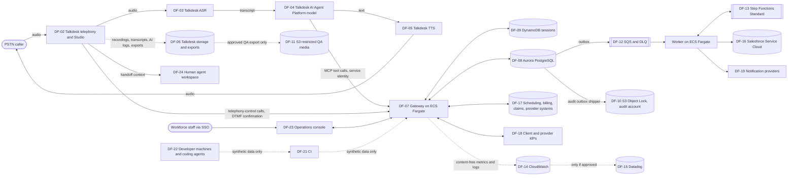
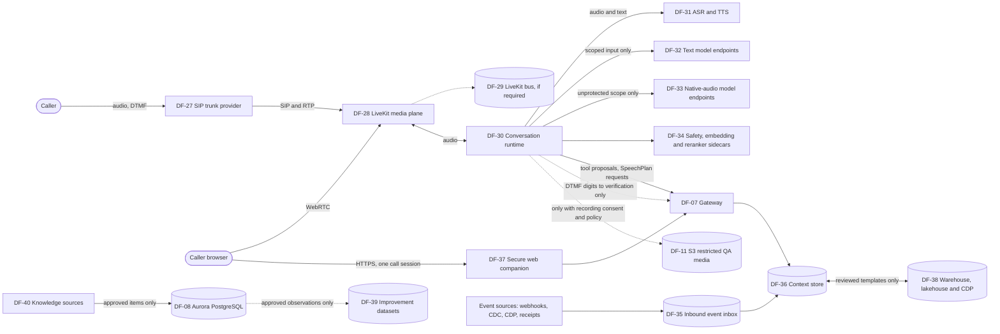

# Data-flow inventory

Engineering draft for review by security and privacy (prerequisite PRQ-003). It maps every PHI
processor, storage location, support-access path, backup, telemetry sink and deletion path in
the designed system (spec section 6). It is not a risk analysis, a BAA review or a compliance
determination; those belong to privacy counsel and security leadership. No production or vendor
account was inspected. Regions, subprocessors and vendor retention are UNKNOWN until written
answers exist.

## Principles applied

* **Raw audio remains sensitive even if the transcript is later redacted (DATA-02).** Original
  audio and pre-redaction transcripts are PHI wherever they are received. Redacting a transcript
  after recognition does not mean the speech processor never received PHI.
* Redaction is probabilistic and does not establish formal de-identification. A redaction
  failure quarantines the artefact from broad access; it never justifies sending raw content to
  a debugging vendor.
* A caller may volunteer clinical details at any time, so every ingress and every processor on
  the call path is treated as receiving PHI, even for administrative intents.
* Default away from psychotherapy notes, therapy-session transcripts, medication histories,
  diagnoses and clinical scoring. The therapy corpus is not used for support fine-tuning,
  retrieval, testing or personalisation.
* Minimise downstream copies: Salesforce receives a concise approved summary and a
  permission-checked evidence reference, not full transcripts. No public or long-lived
  recording links.
* No PHI in URLs, metric labels, alert text, resource names, trace baggage, error messages,
  workflow names or support tickets (`docs/ARCHITECTURE.md` convention 2).
* Zero retention is verified per feature and endpoint, including exceptions; it is never
  assumed (PRQ-002).
* An AWS BAA does not make Talkdesk, Salesforce, a voice vendor or an observability service
  covered (spec section 2).

## Data classes

Retention classes follow `DataClass` in `platform/src/protocol/common.ts`; durations are set by
privacy counsel ([`retention-matrix.md`](retention-matrix.md)). Payload classifications follow
`Classification` (`PUBLIC`, `INTERNAL`, `PHI`, `PHI_RESTRICTED`, `FINANCIAL`, `VERIFICATION_SECRET`).

| Retention class | Content | Typical classification |
|---|---|---|
| `TRANSIENT_CONVERSATION` (RM-01) | Live audio, ASR hypotheses, model context, tool arguments and results in flight, session state | PHI, VERIFICATION_SECRET (portal/DTMF only), FINANCIAL |
| `BUSINESS_RECORD` (RM-02) | Action ledger, support requests, Cases, workflow state, verified support memory, receipts | PHI, PHI_RESTRICTED, FINANCIAL |
| `RESTRICTED_QA_MEDIA` (RM-03) | Recordings and transcripts retained for approved QA or evaluation | PHI, PHI_RESTRICTED |
| `SECURITY_AUDIT` (RM-04) | Audit events (metadata), manifests, access reviews, approvals, deletion and drill records | INTERNAL (opaque references only) |

## Diagram

Solid arrows carry PHI in the designed flow. Dotted arrows are restricted, conditional or
must stay free of PHI.

## Inventory

BAA status is **UNKNOWN** for every external processor until privacy counsel records the
executed agreement and the exact covered services (PRQ-002, PRQ-038). Region is UNKNOWN until
VQ-TD-04, VQ-SF-10 and VQ-AWS-06 are answered.

| ID | Component | Role | Data classes and classification | Storage location | Support-access path | Backups and derived copies | Deletion path | BAA status | Retention ref | Status |
|---|---|---|---|---|---|---|---|---|---|---|
| DF-01 | Carrier / PSTN | Transport outside the platform | Audio (PHI) | Carrier networks | Carrier | UNKNOWN | Not controllable | Not applicable (carrier transport); counsel to confirm | — | UNKNOWN |
| DF-02 | Talkdesk telephony and Studio | Processor; routing, queues, recordings if enabled, Studio variables, execution logs | RM-01 audio; Studio variables (opaque session reference, Auth Gate boolean; must never hold OTP digits — VQ-TD-48) | Talkdesk (region UNKNOWN) | Talkdesk staff and subprocessors (VQ-TD-06); tenant admins | Recordings, Studio logs, reporting exports (UNKNOWN) | Vendor deletion request and verification (VQ-TD-05) | UNKNOWN | RM-01, RM-03 | UNKNOWN |
| DF-03 | Talkdesk ASR | Processor; receives raw audio | RM-01 raw audio and pre-redaction transcript (PHI; DATA-02) | Talkdesk / subprocessors (UNKNOWN) | UNKNOWN (VQ-TD-06) | UNKNOWN | Vendor deletion request | UNKNOWN | RM-01 | UNKNOWN |
| DF-04 | Talkdesk AI Agent Platform model | Processor; untrusted conversational layer | RM-01 transcript and model context (PHI); tool results already field-masked by policy | Talkdesk / model subprocessors (UNKNOWN, VQ-TD-01, VQ-TD-02) | UNKNOWN | AI conversation logs, Simulator and evaluation data (UNKNOWN) | Vendor deletion request; training-use terms (VQ-TD-03) | UNKNOWN | RM-01, RM-03 | UNKNOWN |
| DF-05 | Talkdesk TTS | Processor | RM-01 rendered text and audio (PHI) | UNKNOWN | UNKNOWN | UNKNOWN | Vendor deletion request | UNKNOWN | RM-01 | UNKNOWN |
| DF-06 | Talkdesk recordings, transcripts, AI logs, Explore exports | Storage at vendor | RM-03 if retained for QA; otherwise RM-01 | Talkdesk (UNKNOWN) | Tenant admins, Talkdesk support | Exports (formats VQ-TD-09) | Vendor lifecycle and deletion request; export copies deleted by owner | UNKNOWN | RM-01, RM-03 | UNKNOWN |
| DF-07 | Gateway (Fastify on ECS Fargate) | Processor; in-memory only | RM-01 tool arguments and results (PHI, FINANCIAL) | Container memory; no PHI written to disk or logs | No interactive access; deploys via CI | None (stateless) | Process exit | AWS: UNKNOWN (VQ-AWS-01) | RM-01 | Offline: gateway module IMPLEMENTED_OFFLINE (LOCAL FIXTURE adapters); deployed: BLOCKED (PRQ-037) |
| DF-08 | Aurora PostgreSQL | Store; ledger, outbox, support requests, workflows, knowledge, memory, audit outbox, gateway tool-request replay cache | RM-02 (PHI, PHI_RESTRICTED, FINANCIAL); RM-01 replay cache (tool results; request hashes stored only as keyed HMAC with a secret pepper, never a digest of the name + DOB locator, DP-02); RM-04 local audit outbox | AWS primary region (UNKNOWN); encrypted with KMS | Application roles with RLS; restricted support requests (clinical-question, privacy-concern and safety-concern handoffs, DP-01) are hidden from the runtime role and readable by the console only after a break-glass `restricted_record:view` decision; break-glass DBA access audited | Automated backups, snapshots, cross-region replica (planned), PITR | Retention job (`platform/src/retention`, exists offline; every class reports `BLOCKED_RETENTION_UNSET` and deletes nothing until durations are approved) plus backup expiry; replay-cache rows purged after their replay window (worker loop `tools.idempotency_purge`); legal hold exceptions | AWS: UNKNOWN | RM-02, RM-04 | Offline: PGlite (ADR-0004); deployed: BLOCKED (PRQ-037) |
| DF-09 | DynamoDB sessions (identity KV store) | Store; trusted session binding; verification abuse monitor | RM-01 actor/subject ids, assurance, consent state (opaque ids; PHI by association); account-keyed abuse-monitor counters (sha256 of the account or destination id, hourly; never linked to a session, AUTH-ENUM-01), class to be confirmed (RM-04 proposed) | AWS primary region (UNKNOWN) | Application only; abuse counters read by security monitoring (`VerificationAbuseMonitor.count`) | PITR backups if enabled; global table replica if used (UNKNOWN) | Application expiry enforced on read; TTL cleanup (abuse counters: `abuseSignalRetentionHours`, an engineering default pending Security approval); backup expiry | AWS: UNKNOWN | RM-01 | Offline: memory fixture; deployed: BLOCKED |
| DF-10 | S3 audit bucket (separate audit account, Object Lock, KMS) | Store; independent append-only evidence | RM-04 security metadata with opaque references (no content) | Audit account (UNKNOWN region) | Auditors via metadata search; audit-account administrators only | Object Lock versions; cross-region copy if approved | Object Lock expiry per approved class; legal hold | AWS: UNKNOWN | RM-04 | Offline: local-filesystem fixture; live sink BLOCKED (PRQ-040) |
| DF-11 | S3 restricted QA media | Store; recordings and transcripts retained for approved QA | RM-03 (PHI, PHI_RESTRICTED) | AWS (UNKNOWN) | Named QA reviewers through audited access | Versions; no public or long-lived links | Lifecycle policy per approved class; verified deletion of derived copies | AWS: UNKNOWN | RM-03 | Not implemented; requires approved purpose (PRQ-003, PRQ-025) |
| DF-12 | SQS queues and dead-letter queues | Transport; outbox delivery | RM-02 minimal message bodies (opaque ids, action references) | AWS (UNKNOWN); KMS | Operators via DLQ repair console flow | Message retention per queue configuration | Queue retention expiry; DLQ repair then delete | AWS: UNKNOWN | RM-02 | Plans only (`infra/terraform/modules/sqs`) |
| DF-13 | Step Functions Standard | Processor; durable follow-up | RM-02 minimal workflow ids and source references; task tokens (secret) in resolved parameters | AWS (UNKNOWN) | Execution history restricted to the worker role and audited break-glass | Execution history (service-managed) | Service history retention (UNKNOWN, record in vendor inventory); no PHI in names or logs | AWS: UNKNOWN | RM-02 | Generated ASL only (ADR-0007); deployment BLOCKED |
| DF-14 | CloudWatch metrics, logs and alarms | Telemetry sink | Content-free: metric names, closed-enum labels, reason codes; no PHI. WAF request logs (log group `aws-waf-logs-<prefix>`) keep request metadata (header names and values other than the redacted ones, URI path, client address) with `authorization`, `cookie`, `mcp-session-id`, `x-vsp-session-ref`, `x-vsp-interaction-id`, `idempotency-key` and the query string redacted (VSP-INF-01) | AWS (UNKNOWN) | SRE and security operations | Log retention per group (TO BE SET) | Log group retention; no PHI to delete by design | AWS: UNKNOWN | RM-04 (operational logs class to be confirmed) | OTel export BLOCKED (PRQ-047) |
| DF-15 | Datadog | Telemetry sink, **only if approved** | Content-free metrics only by default | Vendor (UNKNOWN) | Vendor and SRE | UNKNOWN | Vendor retention | UNKNOWN (VQ-OBS-01) | — | Not in scope unless approved (PRQ-047) |
| DF-16 | Salesforce Service Cloud | System of record for Cases | RM-02 audience, opaque subject reference, issue category, disposition, minimised summary, receipts, source call ids, consent status; restricted records (a minimal RESTRICTED Case) for clinical-question, privacy-concern and safety-concern handoffs, privacy complaints and safety events, with no subject reference for clinical-question records (DP-01) | Salesforce org (region UNKNOWN, VQ-SF-10) | Support staff per sharing model; integration identity restricted | Salesforce backups and sandboxes (sandbox must not copy production data, VQ-SF-02) | Salesforce deletion per approved class; derived reports | UNKNOWN (VQ-SF-01) | RM-02 | Live adapter BLOCKED (PRQ-006) |
| DF-17 | Business systems (scheduling, billing, claims, provider network) | Systems of record | RM-02 appointments, invoices, claims, onboarding, remittances (PHI, FINANCIAL) | Owner systems (UNKNOWN) | Owner teams | Owner-managed | Owner-managed; not changed by this platform | UNKNOWN | RM-02 (owner schedules) | Live adapters BLOCKED (PRQ-007) |
| DF-18 | Client and provider IdPs (OIDC); workforce SSO | Processors; authentication | Identity claims (sub, amr, auth_time); registered channels | IdP vendors (UNKNOWN) | Identity owner | IdP-managed | IdP-managed | UNKNOWN | — | Live verifier present offline only; BLOCKED (PRQ-036) |
| DF-19 | Notification providers (SMS, voice, email) | Processors | Neutral templates only; destination channel references; OTP codes if enabled | Vendor (UNKNOWN) | Vendor support | Delivery logs (UNKNOWN) | Vendor retention | UNKNOWN (PRQ-048) | RM-01 | Local fixture only; every send is refused before the provider while `OUTBOUND_NOTIFICATIONS` or `INTEGRATION notifications` is engaged or switch state is unreadable (OPS-KS-01) |
| DF-20 | Secrets Manager and KMS | Key and secret custody | Credentials and keys, no PHI | AWS (UNKNOWN) | Security admins | Service-managed | Rotation and scheduled key deletion | AWS: UNKNOWN | RM-04 (rotation evidence) | Plans only |
| DF-21 | CI | Build and test | **Synthetic data only**; no PHI in CI logs | CI provider (GitHub Actions per `.github/workflows`; account settings UNKNOWN) | Repository maintainers; the CI deploy roles are denied the listed data-plane reads, exports and sharing calls, with residual paths through the resource policies Terraform manages (VSP-INF-02, `infra/terraform/README.md`) | Build logs, SBOM and scan artefacts | CI artefact retention (UNKNOWN) | Not a PHI processor by design | — | Workflows defined; actions not yet pinned by SHA (PRQ-041); no run evidence yet |
| DF-22 | Developer machines and coding-agent environments | Development | **Synthetic data only**; never real transcripts, credentials or patient records (spec section 1) | Local | Developers | — | — | Not a PHI processor by design | — | Enforced by process; approved environments list pending (PRQ-003) |
| DF-23 | Operations console (browser) | Presentation to staff | Minimised fields per policy field mask; no raw queries or unrestricted transcript downloads | Browser memory only | Staff per role | None (no downloads) | Session end | — | — | Offline: console API and UI IMPLEMENTED_OFFLINE (LOCAL FIXTURE sign-in); workforce SSO BLOCKED (PRQ-036) |
| DF-24 | Human agent workspace (Talkdesk) | Presentation to the receiving human | Handoff package: stated issue, assurance and limits, authorised subject, consent, receipts, references, language and accommodations, safety-routing reason | Talkdesk (UNKNOWN) | Receiving agent | Talkdesk interaction record (UNKNOWN) | Vendor lifecycle | UNKNOWN | RM-01, RM-02 | Context delivery UNKNOWN (VQ-TD-39) |
| DF-25 | Evaluation and LLM judges | Processors for evaluation | Synthetic or consented scenarios only; production-derived scenarios only after approved access and minimisation | Approved environments only (UNKNOWN) | QA reviewers | Scorecards (append-only) | Per RM-03 | UNKNOWN | RM-03 | Not used with real data |
| DF-26 | Hosted payment page / PCI provider | External; link only | Card data never enters this platform | Provider (UNKNOWN) | Provider | — | — | UNKNOWN | — | UNKNOWN (PRQ-050) |

## Follow-on components (reference runtime, models, context and improvement)

Added 2026-10-19 for the follow-on programme. These rows cover the flows that `docs/ARCHITECTURE.md`
section 6.5 adds (TDF-01 to TDF-04, TDF-09, TDF-15 and TDF-17 to TDF-21); the flows it maps to existing
rows keep those rows. Every component below was a design target when it was added; the Status column says
where phase B code now exists (the flows that code implements are listed in the next section). Nothing
here was inspected in a vendor or production account. The Status column states the two status axes of
[ADR-0018](../adr/ADR-0018-followon-product-architecture.md) decision 7 and names the work package
(`docs/followon/work-packages.yaml`) that builds the component ([`../DECISIONS.md`](../DECISIONS.md)
D-09). External inputs are named by their activation register id (`AIN-NN`,
`docs/followon/activation-register.yaml`). The principles above apply unchanged: raw audio and
pre-redaction transcripts stay sensitive wherever they are received (DATA-02), and zero retention is
verified per feature and endpoint, never assumed. Threats for these components are in
[`../security/threat-model.md`](../security/threat-model.md) section 8.

Solid arrows carry PHI in the designed flow. Dotted arrows are restricted or conditional.

| ID | Component | Role | Data classes and classification | Storage location | Support-access path | Backups and derived copies | Deletion path | BAA status | Retention ref | Status |
|---|---|---|---|---|---|---|---|---|---|---|
| DF-27 | SIP trunk provider (reference route) | Processor; carries inbound and outbound calls and SIP transfer legs for the LiveKit runtime (TDF-01) | RM-01 audio (PHI; DATA-02); signalling with calling and called numbers; DTMF events (VERIFICATION_SECRET whenever OTP over DTMF is enabled, which stays disabled until qualified) | Carrier networks and call-detail records (UNKNOWN) | Carrier support (UNKNOWN) | Call-detail records; any carrier-side recording (UNKNOWN; carrier recording must stay off unless consent and policy allow it) | Carrier contract terms (UNKNOWN) | UNKNOWN (AIN-02, AIN-50) | RM-01 | Software `MISSING` (WP-12 trunk profiles, WP-27 outbound calls, WP-28 SIP transfers); environment `NOT_CONFIGURED` (AIN-50) |
| DF-28 | LiveKit media plane (`livekit-server`, `livekit-sip`, TURN), self-hosted | Processor; media routing and SIP gateway (TDF-01) | RM-01 raw audio (PHI; DATA-02); participant identities and attributes (may include the caller number); DTMF events | Media-host memory only; LiveKit egress recording off unless recording consent and policy allow it, and then written to DF-11 only | No interactive access; changes through the deploy path; LiveKit admin API not exposed publicly | None by design; host logs content-free | Process exit; no media written to disk | AWS: UNKNOWN (AIN-02); self-hosted software, so no additional vendor processor | RM-01 | Software `MISSING` (WP-11, WP-12, WP-39); environment `NOT_CONFIGURED` (AIN-01, AIN-47, AIN-50; security review AIN-46) |
| DF-29 | LiveKit internal bus (Redis; ElastiCache in AWS), only if the pinned LiveKit version needs it | Store; media-plane signalling state (TDF-15) | RM-01 room and participant state (may include the caller number); no business state | Private subnet; a container locally | No interactive access | Snapshots: none planned (decided in WP-39) | Key expiry and process exit | AWS: UNKNOWN (AIN-02) | RM-01 | Software `MISSING` (WP-11, WP-39); whether the bus is needed is unverified (ADR-0018 open item 2); environment `NOT_CONFIGURED` |
| DF-30 | Conversation runtime worker (`media/` package with the harness, model adapters and release guard) | Processor; in memory only; source of TDF-02 to TDF-04 | RM-01 audio frames, partial and final transcripts, harness state and masked facts from the gateway (PHI, FINANCIAL); model credentials; never verification secrets | Container memory; minimized turn envelopes go through the gateway to DF-08 | No interactive access; deploys via CI | None (stateless); audio evidence only to DF-11, with consent | Process exit | AWS: UNKNOWN (AIN-02) | RM-01 | Software `MISSING` (WP-10 to WP-17); environment `NOT_CONFIGURED` |
| DF-31 | ASR and TTS: self-hosted sidecars (`sidecars/speech`) or managed providers | Processors; receive raw audio and text to synthesize (TDF-02; replaces DF-03 and DF-05 on the reference runtime) | RM-01 raw audio and pre-redaction transcripts (PHI; DATA-02); text for synthesis (PHI, FINANCIAL) | Self-hosted: sidecar memory in private subnets; managed: provider (region UNKNOWN, recorded per registry entry) | Self-hosted: none interactive; managed: provider support (UNKNOWN) | Self-hosted: none; managed: provider logs (UNKNOWN; zero retention verified per endpoint) | Self-hosted: process exit; managed: provider deletion terms (UNKNOWN) | Self-hosted: AWS UNKNOWN (AIN-02); managed: UNKNOWN (AIN-49) | RM-01 | Software `MISSING` (WP-13; registry entries WP-09); environment `NOT_CONFIGURED` (AIN-26, AIN-27 for real-time GPU throughput) |
| DF-32 | Text model endpoints: Amazon Bedrock, OpenAI Responses, self-hosted vLLM | Processors; receive scoped model input and return proposals only (TDF-03; replaces DF-04 on the reference runtime) | RM-01 transcript, policy-masked ContextSnapshot facts and the permitted tool list (PHI, FINANCIAL); never verification secrets | Managed: provider (region UNKNOWN, recorded per registry entry); vLLM: GPU host memory in private subnets | Managed: provider support (UNKNOWN); vLLM: none interactive | Managed: provider logging and abuse-monitoring terms (UNKNOWN, verified per endpoint); vLLM: none | Managed: provider terms (UNKNOWN); vLLM: process exit | UNKNOWN per provider, endpoint and region (AIN-49) | RM-01 | Software `MISSING` (WP-08 adapters, WP-09 registry, WP-10 scope builder); environment `NOT_CONFIGURED` (AIN-26, AIN-27, AIN-29) |
| DF-33 | Native-audio model endpoints: GPT-Live client delegation, Nova 2.5 Sonic, opt-in open-weight experiments | Processors; full-duplex audio (TDF-04) | RM-01 caller audio both ways (PHI; DATA-02 applies even with an unprotected context scope, because callers volunteer details); no protected facts in the session scope | Provider (region UNKNOWN); experiments: GPU host memory | Provider support (UNKNOWN) | Provider session and audio retention (UNKNOWN; API details unverified, ADR-0018 open item 1) | Provider terms (UNKNOWN) | UNKNOWN per provider, region and data path (AIN-49) | RM-01 | Software `MISSING` (WP-16); environment `NOT_CONFIGURED` (AIN-26, AIN-29) |
| DF-34 | Safety classifier, embedding and reranker sidecars (`sidecars/safety`, `sidecars/retrieval`) | Processors; receive transcript text and retrieval queries (TDF-18) | RM-01 transcript and query text (PHI possible); embeddings of the approved corpus only, never an embedding index of caller transcripts | Sidecar memory in private subnets | None interactive | None for queries; corpus embeddings live in DF-08 | Process exit; corpus embeddings purged on source deletion (DF-40) | AWS: UNKNOWN (AIN-02) | RM-01 (queries), RM-02 (corpus embeddings) | Software `MISSING` (WP-15, WP-20); the WildGuard auxiliary stays disabled until its gated terms are accepted (AIN-28); environment `NOT_CONFIGURED` |
| DF-35 | Authenticated event ingress and inbound inbox: vendor webhooks, CDC, CDP events, delivery receipts, LiveKit and Talkdesk carrier events | Store; durable inbox written before acknowledgment (TDF-09) | RM-02 event payloads (PHI possible), payload digests and verifying credential versions; quarantined unknown fields; restricted raw replay artifacts | Aurora (inbound inbox and carrier-event inbox), payloads encrypted | Operators only through audited replay of dead-lettered events | Database backups; raw replay artifacts in restricted storage, not ordinary logs | Retention job per approved class; deletion orchestrator (WP-22) | AWS: UNKNOWN | RM-02 | Software `IMPLEMENTED` for the WP-04 inbox (DF-41 to DF-52), not composed in the live container yet (ADR-0023 decision 11); `MISSING` (WP-28 carrier events); environment `NOT_CONFIGURED` (AIN-07, AIN-38) |
| DF-36 | Context store: support timeline, ContextFacts, projections, source watermarks, identity links and ContextSnapshot caches | Store; permissioned history plus event-fed current state (TDF-09, TDF-06) | RM-02 timeline events and facts with provenance and source versions (PHI, PHI_RESTRICTED, FINANCIAL); the identity graph, which is sensitive in itself (FO-07-15); special-note record types refused | Aurora with RLS; caches keyed by tenant, subject, role, purpose, policy and data revision and session generation | Staff through the console within the identity scope; restricted records per DP-01 | Database backups; projections and caches are derived copies | Deletion, correction and tombstones across timeline, facts, projections, embeddings and caches, re-applied on restore (WP-22) | AWS: UNKNOWN | RM-02 | Software `MISSING` (WP-18, WP-19, WP-24, WP-22); environment `NOT_CONFIGURED` (AIN-38) |
| DF-37 | Secure web companion (caller browser and the companion service) | Presentation to the caller; review, confirmations and asynchronous replies (TDF-17) | Minimum necessary prepared-action summaries and case status (PHI, FINANCIAL); no PHI or secrets in URLs | Browser memory only; the service is stateless and writes through the gateway | Caller only; no staff access path | None (no downloads planned) | Session end and idle expiry | Hosting: AWS UNKNOWN; caller IdP: UNKNOWN (AIN-12) | RM-01, RM-02 | Software `MISSING` (WP-27); environment `NOT_CONFIGURED` (AIN-12) |
| DF-38 | Warehouse, lakehouse and CDP sources: Snowflake SQL API, Iceberg through Athena and Glue, Segment-compatible CDP | Systems of record and processors for context (TDF-19) | RM-02 bounded query results through reviewed templates (PHI, FINANCIAL); CDP events limited by purpose and field filters; no transcript, inferred distress or treatment fact to marketing destinations (FO-06-59) | Tenant accounts (region UNKNOWN) | Tenant data owners | Source-managed; time travel off by default on queries | Source-managed; suppression and deletion consumer for CDP events | UNKNOWN (AIN-38) | RM-02 (owner schedules) | Software `MISSING` (WP-21); environment `NOT_CONFIGURED` (AIN-38) |
| DF-39 | Improvement pipeline, datasets and trained artifacts | Processor and store for evaluation, tuning and training (TDF-20) | Synthetic by default; production-derived items only with a DATASET_USE approval bound to the dataset digest, minimized, with provenance, licence and consent; trained artifacts may memorize their training data | Approved bounded environment only (location to be set by WP-37 and approved) | Named reviewers; the improvement service identity has no publish or permission rights | Dataset versions and trained artifacts | Dataset registry retention and deletion; handling of artifacts trained on later-deleted data is an open question for privacy counsel | Not a PHI processor unless a dataset approval exists (AIN-44) | RM-03 | Software `MISSING` (WP-36, WP-37); environment `NOT_CONFIGURED` (AIN-44) |
| DF-40 | Knowledge source connectors: Salesforce Knowledge, reviewed URL allowlists, object storage, KB APIs | Sources of the approved corpus (TDF-21) | Approved public and internal content; not caller data by design; items with detected PHI or hidden instructions are quarantined | Source systems; approved snapshots in DF-08 | Knowledge owners and editors | Snapshots, full-text and pgvector indexes of the approved corpus | Deletion and archival propagation with re-embedding and purge of embeddings (FO-06-82) | Not a PHI processor by design; Salesforce: UNKNOWN (AIN-09) | RM-02 | Software `MISSING` (WP-20); environment `NOT_CONFIGURED` (AIN-32) |

## Phase B implemented flows (merged by WP-07, 2026-10-21)

The phase B packages drafted the data flows their code implements in `docs/privacy/data-flows/proposed/<WP-id>-flows.md`; the phase B integration package (WP-07) merged them here with DF ids and removed the drafts, and added the flows of the live composition itself. Unlike the component rows above, each row is one flow, implemented in code and exercised against local emulators with SYNTHETIC data only. Software status is the drafting package's; every environment is `NOT_CONFIGURED` and no flow carries real data. This is an engineering inventory for privacy and security review (PRQ-003), not a risk analysis or a compliance determination.

### Inbound event inbox, route-audit journal and independent audit export (WP-04)

Implemented and exercised against protocol emulators only (Layer 2, SYNTHETIC data). Retention durations marked "approval" are not invented: the code refuses to run without an approved value or takes it from the source profile, which needs approval per source.

| ID | Flow | Data | Source -> destination | Storage and protection | Access | Retention / deletion | Logs and metrics | Status |
|---|---|---|---|---|---|---|---|---|
| DF-41 | Inbound vendor event (webhook, delivery receipt, CDC push) | Raw event body as sent by the vendor; may contain PHI (identifiers, message status, case fields) | Vendor -> gateway `POST /v1/ingress/:sourceId/events` -> `inbound_events` (Aurora) | Authenticated before persistence; body sealed with a per-event KMS data key (AES-256-GCM, encryption context and AAD bound to tenant, source, event id, payload digest); stored only in restricted ciphertext columns; FORCE RLS per tenant | Gateway role: insert, identity and digest columns only; console role: metadata and replay columns, never the payload; worker role: decrypts to process; auditor: none | Raw payload purged after the source profile's `rawRetentionDays` (approval per source) once the row is terminal; digest, ids, schema, auth mechanism and credential version kept as evidence | Source ids (field `integration`), inbox ids, decisions (`outcome`), payload digests and reason codes; never bodies, tokens, signatures or secrets (the verifying credential version is on the row and in the audit event, not in logs). `vsp_inbox_*` metrics without tenant or subject labels | Software `IMPLEMENTED` (WP-04); environment `NOT_CONFIGURED` |
| DF-42 | LiveKit server webhook (room and participant lifecycle) | Event JSON as livekit-server sends it: room sid and name, timing, codec list and the room's TURN credential (`room.turnPassword`); participant events would add identities | livekit-server (media plane) -> gateway `POST /v1/ingress/:sourceId/events` -> `inbound_events` | As the vendor event above: HS256 JWT binding the body's SHA-256 verified before persistence, body sealed in the restricted columns; the TURN credential is a secret and stays only in the sealed payload | As above | As above (`rawRetentionDays` of the LiveKit source, approval) | As above: never the payload, the token or the API secret (Layer 2: `ingress/livekit-webhook.test.ts`) | Software `IMPLEMENTED` (WP-04); environment `NOT_CONFIGURED` |
| DF-43 | Inbound stream record (existing Kinesis or Kafka/MSK stream) | As above | Tenant stream -> worker `StreamIngestor` -> `inbound_events` | As above; checkpoints and gaps in `inbox_stream_checkpoints` / `inbox_stream_gaps` (positions only) | Worker | As above | Positions, lag and gap counts only | Software `IMPLEMENTED` (WP-04); environment `NOT_CONFIGURED` |
| DF-44 | Inbound credentials | Webhook signing secrets, shared bearer secrets, pinned certificate fingerprints | Secrets Manager -> gateway memory (bounded cache) | Never stored in the inbox, logs or errors; only the Secrets Manager version id is recorded per event | Gateway task role (`secretsmanager:GetSecretValue` on the source's secret) | Rotation through AWSCURRENT / AWSPREVIOUS / AWSPENDING with a bounded overlap | Version ids only | Software `IMPLEMENTED` (WP-04); environment `NOT_CONFIGURED` |
| DF-45 | Operator replay of an inbound event | Operator staff ref, reason code, MFA time | Console -> `inbound_replays`, `audit_outbox` | Audit event written first in the same transaction | Console role | Follows the audit retention class | `inbox.replay` audit event (codes and opaque ids) | Software `IMPLEMENTED` (WP-04); environment `NOT_CONFIGURED` |
| DF-46 | Route-audit journal | Audit event input of a human or safety route (opaque ids, action codes, reason codes; no free text, schema-enforced) | Gateway / worker -> `audit_deferred` (Aurora); fallback -> DynamoDB journal table | DynamoDB item carries the same digest-checked input; PostgreSQL FORCE RLS | Runtime, console and worker roles (insert, select, state columns); auditor read | Rows stay as evidence (RECORDED / DROPPED with the event ids); DynamoDB entries marked drained; retention of the DynamoDB table is a Terraform decision (WP-39) | `audit.journal.*` logs and `vsp_audit_journal_*` metrics: codes, opaque ids, counts | Software `IMPLEMENTED` (WP-04); environment `NOT_CONFIGURED` |
| DF-47 | Route intents and reconciliations | Opaque call, correlation and incident ids; route kind | Gateway / handoff -> `route_audit_intents`; worker -> `route_audit_reconciliations`, `audit_outbox` markers | FORCE RLS | Runtime / console / worker insert; auditor and verifier read | Follows the audit retention class | `vsp_route_audit_reconciled_total` | Software `IMPLEMENTED` (WP-04); environment `NOT_CONFIGURED` |
| DF-48 | Independent audit export | Audit events (schema-enforced: opaque ids, codes, digests, evidence pointers) and signed manifests | Worker (exporter identity) -> S3 Object Lock bucket in the audit account | Object Lock retention, SSE-KMS (audit-account key), checksums, manifest signatures (audit KMS key, `ECDSA_SHA_256`) | Exporter: put only; verifier: list / get and public key only; nobody deletes before retention | `SECURITY_AUDIT` retention needs counsel approval (the sink refuses `null`) | Manifest ids, sequences and counts | Software `IMPLEMENTED` (WP-04); environment `NOT_CONFIGURED` |
| DF-49 | Inbound replay keys | SHA-256 of (source, token id) and the SHA-256 of the bytes the token first authenticated; never the token | Gateway / worker -> `inbound_replay_keys` (Aurora, migration 2043) | FORCE RLS per tenant; immutable; deletable only once expired | Runtime and worker | Until the token expires, then purged by the worker | `inbox.replay_refused` (source id and reason code) | Software `IMPLEMENTED` (WP-04); environment `NOT_CONFIGURED` |
| DF-50 | Credential promotion observations | Credential reference (secret ARN, configuration) and Secrets Manager version ids with observation times | Gateway / worker -> `ingress_credential_promotions` (Aurora, migration 2044) | Append-only (only the last observation moves forward) | Runtime and worker write; console reads | Kept (one row per credential version) | None (no key material) | Software `IMPLEMENTED` (WP-04); environment `NOT_CONFIGURED` |
| DF-51 | Verifier sink session | Temporary list/get credentials scoped to the audit bucket (local: MinIO STS session policy; AWS: the verifier task role) | STS -> verifier memory | Never logged or stored | Verifier | Session lifetime (15 min) | None | Software `IMPLEMENTED` (WP-04); environment `NOT_CONFIGURED` |
| DF-52 | Verifier report | Finding codes, stream names, sequences, opaque ids, counts per reconciliation source (`expected`, `observed`, `unverified`, `discrepancies`) | Verifier task -> stdout / JSON file / metrics | Content-free by construction | Security operations | Per incident record | `vsp_audit_verifier_runs_total`, `vsp_audit_reconciliation_discrepancies_total` | Software `IMPLEMENTED` (WP-04); environment `NOT_CONFIGURED` |

Raw replay payloads are kept past their retention while a legal hold applies (`legal_holds`, any data class;
a subject-scoped hold keeps the tenant's payloads because inbound rows carry no subject).

Open points for review: retention per inbound source (raw replay window; the dataset `inbound_raw_payloads` is
not yet registered with an approved duration in the retention registry), the DynamoDB journal table's TTL and
encryption key, the audit-account bucket's retention and Object Lock mode (AIN-01, AIN-03), and the verifier
task's identity (WP-39).

### Caller and workforce identity (WP-05)

Implemented and exercised against local Keycloak and postgres:16 with SYNTHETIC identities only. Retention periods need approval; the tables are not yet registered with the retention job.

| ID | Flow | Data | Source -> destination | Storage and protection | Access | Retention / deletion | Logs and metrics | Status |
|---|---|---|---|---|---|---|---|---|
| DF-53 | Workforce sign-in | Authorization code, state, nonce, PKCE verifier and challenge, redirect URI | Browser <-> console API <-> workforce IdP | The start stores nothing: nonce hash, challenge, a redirect digest and the lifetime travel in the sealed state (HMAC, tenant and issuer bound; nothing secret in it). The exchange records the state's single use (`console_login_transactions`: state hash, nonce hash, challenge, redirect, inserted consumed); TLS to the IdP over the egress-classified transport | Console API only | Single-use rows are deleted by the session sweeper in bounded batches once their state has expired; the database refuses to delete a live one (migration 2052) | Reason codes and correlation ids; never code, state, nonce or verifier | Software `IMPLEMENTED` (WP-05); environment `NOT_CONFIGURED` |
| DF-54 | Workforce ID token | Issuer, subject, membership claim (the console client's roles), amr, auth_time, session id | Workforce IdP -> console API memory | Not stored; issuer and subject as digests, roles derived from the membership claim stored on the session row | Console API only | Not retained | Staff id (opaque), roles, reason codes | Software `IMPLEMENTED` (WP-05); environment `NOT_CONFIGURED` |
| DF-55 | Console session | Bearer hash, family id, staff id, roles, activity and expiry times, refresh-in-flight (claim) time, sealed IdP refresh token | Console API -> `console_sessions` (Aurora) | Bearer stored as SHA-256 only; refresh token sealed with AES-256-GCM (key id per row, AAD session hash); revocation one way | Console API role | Ends at revocation, idle or absolute expiry; rows deletable after expiry (retention registration open) | Session events audited with reason codes (`console.auth.*`); a terminal closure whose audit write fails is applied without its events (it only revokes and suspends), which are then appended on their own, and the error log `console.sso.terminal_audit_unwritten` names any still missing | Software `IMPLEMENTED` (WP-05); environment `NOT_CONFIGURED` |
| DF-56 | Offboarding check | Sealed refresh token (unsealed in memory), introspection result (active, subject, groups; an absent groups claim is read as no groups) | Console API -> workforce IdP introspection and revocation endpoints | TLS; not stored beyond the session's last check time and roles | Console API only | Not retained | `STAFF_DEPROVISIONED`, `STAFF_NOT_PROVISIONED`, `STAFF_ACTIVE_STATE_UNVERIFIED` reason codes | Software `IMPLEMENTED` (WP-05); environment `NOT_CONFIGURED` |
| DF-57 | Break-glass and access reviews | Requester, decider, reviewer staff ids, reason codes, opaque ticket reference, times, outcomes | Console -> `console_break_glass_requests`, `console_break_glass_grants`, `console_access_reviews` | Database separation-of-duty checks; no free text | Security admins (decide, review), requester (own requests), auditors (reviews, read) | Audit-evidence retention (approval open) | Audit events with typed opaque references | Software `IMPLEMENTED` (WP-05); environment `NOT_CONFIGURED` |
| DF-58 | Recovery identities | Custodian staff id, public P-256 JWK, attestation reference, roles, enrollment challenge (hash), holder confirmation time, suspension reason, activation challenge and request nonce (hashes), signatures | Security admins and the holder's own SSO session -> `console_recovery_identities`, `console_recovery_activations`; the holder's latest positive IdP evidence is read from `console_sessions` (time and roles of the newest SSO confirmation) | Public keys only (private keys stay on custodian hardware); one-time enrollment challenge shown once to the proposer and stored as a hash; single-use activation challenges and request nonces stored as hashes; at most 3 pending and 20 per hour per identity, counted over requests signed by the custodian | Security admins (auditor read without the challenge hash) | Revoked and suspended identities and activations kept for audit (activations are evidence of the recovery path); `console_sessions` retention must be at least `holderSsoMaxAgeSeconds` (14 days) or custodians lose the path early | Audit events with typed opaque references (`console.recovery_identity.suspended` / `reinstated`) | Software `IMPLEMENTED` (WP-05); environment `NOT_CONFIGURED` |
| DF-59 | Anonymous sign-in refusals | Action, reason code, correlation id, a suppressed count | Console exchange endpoint -> audit log through the anonymous audit budget (per instance memory window) | At most one audit event per action and reason per 60 s window per instance; the count of the refusals suppressed in between rides on the next event; one log line per window | Auditors | Audit retention | Content-free: no code, state, verifier, token or IdP subject | Software `IMPLEMENTED` (WP-05); environment `NOT_CONFIGURED` |
| DF-60 | Caller session activity and basis | `lastActivityAt`, `lapsedActorId`, processing basis (kind, purpose, approval ref) | Identity service -> session record (DynamoDB) | Existing session record; no new data class; actor id is an opaque id | Gateway, identity service | Session TTL (unchanged) | `identity.session.idle_expired`, `identity.verification.idp_unavailable` content-free logs | Software `IMPLEMENTED` (WP-05); environment `NOT_CONFIGURED` |

Open points for review: retention periods for the console session and login tables and for break-glass,
access-review and recovery records; the jurisdiction and processing bases per role (counsel input); sealing
key custody and rotation for the IdP refresh tokens.

### Connector runtime (WP-06)

Implemented and exercised against the protocol emulator only (SYNTHETIC data). Retention classes come from each connector profile and need approval per tenant and vendor.

| ID | Flow | Data | Source -> destination | Storage and protection | Access | Retention / deletion | Logs and metrics | Status |
|---|---|---|---|---|---|---|---|---|
| DF-61 | Connector read | Vendor records mapped to declared target fields; PROHIBITED fields never leave the mapping; classes per field (INTERNAL, PHI, FINANCIAL, ...) | Vendor API -> connector runtime (worker or gateway process memory) -> the calling module | TLS to an allowlisted host; egress class checked per request; response bounded; drifted records refused whole | Trusted server modules only (module register rule 3) | Per stream `retentionClass` and `deletionBehavior` from the profile (`retentionRulesFor`, consumed by WP-22) | Reason codes, opaque ids, digests; `vsp_connector_*` metrics with closed labels | Software `IMPLEMENTED` (WP-06); environment `NOT_CONFIGURED` |
| DF-62 | Connector write | Declared request-body fields only (typed, bounded), server-derived idempotency key | Calling module (action executor) -> vendor API | As above; content-free receipt (request / response digests, secret version id) | Action executor (rule 2) | Vendor-side retention per contract; local receipt follows the action ledger's retention | Digests and outcome codes; never body values | Software `IMPLEMENTED` (WP-06); environment `NOT_CONFIGURED` |
| DF-63 | Incremental read and checkpoint | Cursor, replay id, watermark, position digest, counters, mapping digest | Vendor change feed -> projection (caller's table) and `connector_checkpoints` (Aurora) | One transaction for projection and checkpoint; RLS per tenant; no delete or truncate; key immutable, counters monotonic | Worker role (read / write), console role (read) | Checkpoints are positions, not records; they follow the connector's lifetime | Positions and counts only | Software `IMPLEMENTED` (WP-06); environment `NOT_CONFIGURED` |
| DF-64 | Credential resolution | Client secrets, private keys, API keys (references in configuration, values in Secrets Manager) | Secrets Manager -> process memory (bounded cache) -> token endpoint | Never in configuration, logs, errors, receipts or metrics; redacting holder | Task role `secretsmanager:GetSecretValue` on the connector's secrets (WP-39) | Rotation by version stage; cache TTL at most one hour | Version ids and resolution results only | Software `IMPLEMENTED` (WP-06); environment `NOT_CONFIGURED` |
| DF-65 | Access tokens | Bearer tokens and granted scopes | Vendor token endpoint -> process memory | Cached per capability credential, bounded by expiry and `tokenMaxAgeSeconds` | Connector runtime only | Discarded on expiry, 401 or restart | Token request results only | Software `IMPLEMENTED` (WP-06); environment `NOT_CONFIGURED` |
| DF-66 | Capability evidence | Probe steps and results, profile digest, capability, level, signature | Probe -> evidence record (WP-32 stores it) | Content digest signed by KMS; no record values | Integration owner, readiness | Evidence expiry per record | Evidence ids and results | Software `IMPLEMENTED` (WP-06); environment `NOT_CONFIGURED` |

Open points for review: retention classes per vendor stream (AIN-36 inputs), which tenant approval covers
PHI egress per connector, and the storage location and retention of capability evidence (WP-32).

### Live composition (WP-07)

Implemented in the live composition ([ADR-0023](../adr/ADR-0023-live-composition-root.md)) and exercised by `make test-integration SUITE=composition` against local emulators with SYNTHETIC data only.

| ID | Flow | Data | Source -> destination | Storage and protection | Access | Retention / deletion | Logs and metrics | Status |
|---|---|---|---|---|---|---|---|---|
| DF-67 | Telemetry export (OTLP/HTTP JSON) | Catalogue metric names and values, allowlisted dimension values, span names and allowlisted span attributes, the resource identity (service name, environment, instance id); never caller content, transcripts, identifiers outside the allowlist or secrets (content attributes cannot be enabled) | Gateway, worker and console processes -> the egress-classified transport -> the approved OTLP collector (an https `TELEMETRY_EXPORTER` destination of the environment) | Nothing persisted in the process beyond the export batch; TLS to the allowlisted host; attributes outside the allowlist dropped before export | The collector's and the observability backend's operators | The observability backend's retention (AIN-37 approval); nothing is exported while `observability.otlp` is null | `vsp_telemetry_export_total{signal,result}`, `vsp_telemetry_attributes_dropped_total` (alarm on any) | Software `VERIFIED_LOCAL` (WP-07); environment `NOT_CONFIGURED` (AIN-37) |
| DF-68 | Connector change-feed index and dead letters | Index: tenant, connector profile, stream, the keyed digest (HMAC-SHA256 under a per-environment HKDF subkey of the request-hash pepper) of each record key, the source update time and run ids; dead-letter envelope: the same keys, the keyed record digest and a reason code, no record content; a low-entropy key (record or appointment number) cannot be confirmed by hashing guesses | Vendor API -> connector runtime in the worker -> `connector_feed_index` (Aurora, migration 2071) in the checkpoint's transaction; records it cannot project -> the feed's SQS dead-letter queue | Aurora with the worker role only; SQS queue encryption (WP-39); when the dead-letter write is refused nothing advances (FT-96) | Worker role; dead letters through the DLQ repair runbook | Not yet registered with the retention job (hand-off to the retention owner, WP-22); the dead-letter queue's message retention is the queue's (WP-39) | `vsp_connector_feed_records_total`, `vsp_connector_feed_dead_letter_refused_total` (alarm) | Software `VERIFIED_LOCAL` (WP-07); environment `NOT_CONFIGURED` (AIN-36) |
| DF-69 | Durable transfer journeys | One row per handoff: opaque ids, template ids, status and reason codes, times and the vendor transfer ids of each attempt; never caller content | Gateway and worker -> `transfer_journeys` (Aurora, migration 2070) | Aurora; compare-and-set on `version`; runtime and worker roles | Runtime and worker roles | Not yet registered with the retention job (hand-off to the retention owner, WP-22) | Transfer metrics of the existing catalogue | Software `IMPLEMENTED` (WP-07); environment `NOT_CONFIGURED` |
| DF-70 | Startup secrets | The database login, the request-hash and OTP peppers, the console session sealer key and the workforce client secret | Secrets Manager -> the starting unit's memory (connector runtime `SecretsManagerSecretResolver`) | Held as `SecretValue` in memory only; never logged, echoed or put in an error (reason codes only) | The unit's task role (WP-39) | Rotation per the secret-rotation runbook; nothing persisted by the platform | `config.*` refusal logs carry the config path and reason code only | Software `VERIFIED_LOCAL` (WP-07); environment `NOT_CONFIGURED` (AIN-36) |
| DF-71 | Readiness surface | Capability ids and their states (CONFIGURED or NOT_CONFIGURED) and check names; no reasons, tenant data or configuration values | Gateway, worker and console -> the load balancer's health checks (`/health/ready`) | Not stored | Health checkers (the unit listens on the interface `VSP_LISTEN_HOST` names; the ALB in AWS, WP-39) | Not stored | `vsp_capability_state{capability,state}` | Software `VERIFIED_LOCAL` (WP-07); environment `NOT_CONFIGURED` |
| DF-72 | Console sign-in rate-limit keys | The client address of a request to the console's sign-in routes (the socket peer, or the right-most untrusted X-Forwarded-For entry when the peer is a trusted load balancer), reduced to a bucket key (IPv4 address, or the IPv6 /64 prefix), and a per-window counter | Load balancer -> the console unit's process memory (`AuthRateLimiter`) | Process memory only, one fixed window (default 60 s) per bucket; expired windows purged; never written to a database, a log or telemetry (only the content-free counter `vsp_console_auth_rate_limited_total`) | The console unit | Purged with the window or on restart | `vsp_console_auth_rate_limited_total` | Software `VERIFIED_LOCAL` (WP-07); environment `NOT_CONFIGURED` |

## Deletion and derived copies

Deletion is not complete until every derived copy is handled: indexes (full-text and pgvector
embeddings of approved knowledge only), caches, read replicas, backups and snapshots, exports,
DLQ messages, vendor copies and evaluation datasets. Deletion verification is recorded as a
`SECURITY_AUDIT` event. Legal hold suspends deletion for the held scope only and is itself
recorded. Durations and mechanisms per class are in [`retention-matrix.md`](retention-matrix.md).

## Open questions for review

| Question | Owner | Reference |
|---|---|---|
| Which Talkdesk features in our plan receive raw audio, and which subprocessors? | Talkdesk / privacy counsel | VQ-TD-01, VQ-TD-06 |
| Is call recording enabled before the consent step anywhere in the tenant? | Talkdesk administrator | VQ-TD-07 |
| Do Studio execution logs persist DTMF-collected values? | Talkdesk / security | VQ-TD-48 |
| Which AWS accounts and components are covered by the BAA? | Privacy counsel / cloud platform owner | VQ-AWS-01, VQ-AWS-02 |
| Is any observability vendor beyond CloudWatch in scope? | Security leadership | VQ-OBS-01 |
| Applicability of Part 2, psychotherapy-note, state and minor rules per record type | Privacy counsel | VQ-LEG-03 |
| Which managed model, ASR and TTS endpoints, regions and features are covered by an agreement, and is zero retention verified for each (DF-31 to DF-33)? | Privacy counsel / procurement | AIN-49, AIN-02, AIN-26 |
| Does the SIP carrier record calls or keep DTMF digits in call-detail records (DF-27)? | Telephony owner | AIN-50 |
| What do GPT-Live and Nova 2.5 Sonic retain from a session (DF-33)? | Privacy counsel / engineering | AIN-26; ADR-0018 open item 1 |
| Does the pinned LiveKit version need the Redis bus, and what does it hold (DF-29)? | Engineering (WP-03, WP-11) | ADR-0018 open item 2 |
| How are trained artifacts handled when a subject in their training data is later deleted (DF-39)? | Privacy counsel | AIN-44 |

## Review record

| Date | Reviewer role | Outcome |
|---|---|---|
| — | Privacy counsel | NOT_RUN (awaiting PRQ-003) |
| — | Security leadership | NOT_RUN (awaiting PRQ-003) |
