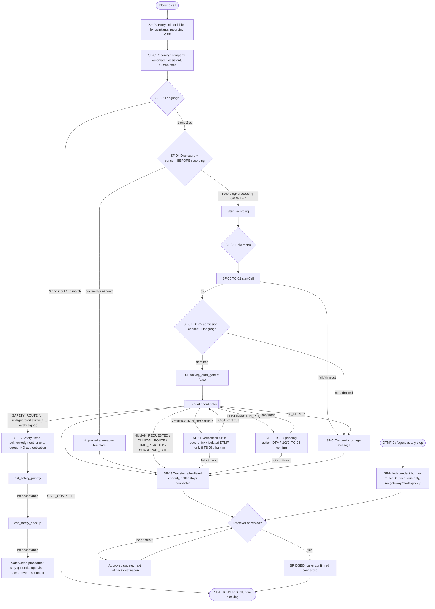

# Studio flow specification — `vsp_main_inbound`

Status: **UNVERIFIED** against any tenant. Apply only in an approved Talkdesk sandbox
(see `docs/release/approval-requests.md`, request AR-01). Every "Talkdesk component"
cell is a *functional* description; the exact Studio component name and UI path are
**to be confirmed from tenant documentation**. Do not substitute a guessed label.

Requirement tags used: AUTH-01..07, DATA-02, DATA-03, ACT-01, ACT-05, SAFE-02..05,
OPS-02, OPS-03, OPS-05, plus `SPEC-<section>.<topic>` for specification clauses without
an invariant id.

## 1. Design rules this flow enforces

1. **Independent human route** (SPEC-3.independent-route, OPS-02). A Studio path from
   every step to a staffed Talkdesk queue exists that requires **no** model response,
   gateway request or policy decision. It is always reachable by DTMF `0` and, where
   the active step accepts speech, by the phrase "agent" (plus the language-specific
   equivalents approved by language leads). Gateway calls made on this path are
   optional, non-blocking and never awaited.
2. **Safety route needs no authentication** (SAFE-02). The safety branch never calls the
   verification Skill, never checks the Auth Gate and never checks payment or account
   ownership. Refusal counters, silence limits, maximum turns and budget limits must
   exit **into** this branch, never terminate it (SAFE-03).
3. **Consent before recording** (DATA-03, SPEC-6.consent). No recording starts before the
   consent branch completes with `recording = GRANTED`. A declining caller is offered
   the approved alternative. No prompt says the call is unrecorded while transcription,
   model processing or another recorder continues.
4. **Auth Gate opens only on strict boolean `true`** from the gateway auth-gate
   operation for the current session generation (AUTH-07, details in `auth-gate.md`).
   The gate variable is initialised by a Studio constant, never copied from a response
   field other than `isAuthenticated`, never from model output.
5. **No arbitrary dial target** (SAFE-05). Studio routes only to queues in its own
   allowlist table (section 4), keyed by `dst_*` destination ids that mirror
   `DESTINATIONS` in `platform/src/fixtures/synthetic-world.ts`. Unknown ids route to
   the default for the exit reason.
6. **Transfer success needs receiver acceptance** (SAFE-04). Queueing the caller is not a
   transfer outcome. The caller stays connected while the human joins.
7. **Fail closed, route safely.** Any gateway timeout, non-2xx, unparseable or
   schema-mismatched response ⇒ Auth Gate stays/turns `false`, protected work is not
   attempted, and the caller is routed to a human or continuity queue. Never a silent
   disconnect.
8. **Verification secrets never reach the model** (AUTH-06). OTP digits are only
   collected by the isolated DTMF step SF-11b, and only if TB-03 is proven.

## 2. Flow variables

Variable names are repository proposals. Talkdesk naming rules and supported types
(in particular whether a native boolean type exists) are **UNKNOWN** — see
`vendor-questions.md` VQ-TD-21. "Model-readable" means visible to the AI agent's
context; "model-writable" must be **No** for every row and is tested (AG-12).

| Variable | Type (required) | Initial value | Written by | Model-readable | Model-writable |
|---|---|---|---|---|---|
| `vsp_auth_gate` | boolean | `false` (Studio constant; see `auth-gate.md` §2 for the "defined-condition" stop rule) | SF-08 init; SF-11 refresh mapping only | No (preferred) | **No** |
| `vsp_session_ref` | string (opaque `ses_*`) | unset → set from TC-01 response | SF-06 | Only if TB-01 option A requires it; never as a tool argument | **No** |
| `vsp_session_generation` | integer | unset → from TC-01 | SF-06, SF-11, SF-13 (TC-10) | No | **No** |
| `vsp_language` | enum `en`,`es`,`other` | unset | SF-02 | Yes | **No** |
| `vsp_consent_recording` | enum `GRANTED`,`DECLINED`,`NOT_CAPTURED` (sent to the gateway as `ConsentValue` `UNKNOWN`) | `NOT_CAPTURED` | SF-04 | No | **No** |
| `vsp_consent_processing` | enum `GRANTED`,`DECLINED`,`NOT_CAPTURED` (sent as `UNKNOWN`) | `NOT_CAPTURED` | SF-04 | No | **No** |
| `vsp_role` | enum mirroring protocol `Role` or `unselected` | `unselected` | SF-05 | Yes | **No** |
| `vsp_mode` | enum `NORMAL`,`CONTINUITY` | `NORMAL` | SF-06, SF-07, SF-C | No | **No** |
| `vsp_ai_admitted` | boolean | `false` | SF-07 | No | **No** |
| `vsp_exit_reason` | enum (section 5) | unset | AI exit mapping | — | Exit reason only, validated against the enum |
| `vsp_destination_id` | string `dst_*` | unset | SF-13 from TC-12 or default table | No | **No** |
| `vsp_pending_action_id`, `vsp_pending_action_digest`, `vsp_turn_id` | string | unset | SF-12 from TC-07 only | No | **No** |
| `vsp_otp_digits` | string | unset; cleared immediately after TC-06 | SF-11b only | **Never** | **No** |

Talkdesk Studio execution logs, variable history and reporting exports may persist
variable values. Before `vsp_otp_digits` is used at all, test DT-04 must prove that the
value is not retained in any Talkdesk log, export or transcript; otherwise SF-11b stays
disabled.

## 3. Gateway operations used by Studio (telephony-control API)

Service identity: `telephony_control` (separate credential from `mcp_tools`, same
`integrationId` for the Talkdesk tenant; see `mcp-connection.md` §3). Paths below are the
ones the gateway **publishes** (`schemas/openapi/gateway.openapi.json`, generated from
`platform/src/gateway/http/telephony-routes.ts`; `drift-check.md --openapi` compares them).
They are not tenant evidence: whether Studio HTTP steps can call them, send headers and
type-check responses is **UNKNOWN** until the tenant tests run. Whether Studio HTTP steps
support OAuth2 client credentials is **UNKNOWN** (VQ-TD-22); a static header credential
requires approval AR-08 (`STATIC_CREDENTIAL_EXCEPTION`).

Every operation except TC-01 and TC-09 takes the bearer session reference only in the
`X-VSP-Session-Ref` header (from `vsp_session_ref`) and the Talkdesk interaction id in
`X-VSP-Interaction-Id` (binds the session to the current call); neither ever appears in a
URL path or query string.

| Op | Port method | Published method + path | Request body (strict) | Success response | On timeout / error |
|---|---|---|---|---|---|
| TC-01 `telephony.startCall` | `SessionService.startCall` | `POST /telephony/v1/calls` | `{callId, callerIdHash: null, consent}` | `201` `StartCallResult` `{sessionRef, sessionGeneration, authGate:false, expiresAt}` | `vsp_mode = CONTINUITY` → SF-C |
| TC-02 `telephony.recordConsent` | `SessionService.recordConsent` | `POST /telephony/v1/session/consent` | `ConsentState` | `{sessionGeneration}` | consent treated as not granted; AI not admitted |
| TC-03 `telephony.selectRole` | `SessionService.selectRole` | `POST /telephony/v1/session/role` | `{role}` | `{sessionGeneration}` | role `unselected`; A0 only |
| TC-04 `telephony.authGate` | `SessionService.authGate` | `GET /telephony/v1/session/auth-gate` | — | `AuthGateResponse` `{isAuthenticated, sessionGeneration, evaluatedAt}` | `vsp_auth_gate = false` |
| TC-05 `telephony.admission` | `AdmissionController.admit` | `GET /telephony/v1/session/admission` | — | `AdmissionDecision` `{admitted, continuity, reasonCode}` | not admitted → SF-C |
| TC-06 `telephony.submitOtp` | `VerificationService.submitOtp` | `POST /telephony/v1/session/otp` | `{challengeId, code}` | `{verified, reasonCode}` (never echoes the code) | not verified → SF-11c |
| TC-07 `telephony.pendingConfirmation` | `ActionService` pending-action read | `GET /telephony/v1/session/pending-confirmation` | — | `{actionId, digest, sessionGeneration, turnId, expiresAt, confirmationTemplateId, promptText, routeToHuman}` — `promptText` rendered by the gateway response gate from the approved `confirmationTemplateId` (`null` ⇒ route to a human) | no confirmation; route SF-13 (human) |
| TC-08 `telephony.confirmAction` | `ActionService.confirm` | `POST /telephony/v1/session/actions/{actionId}/confirm` | `{digest, sessionGeneration, turnId, method: dtmf_keypress, capturedAt}` (the gateway builds the `ActionConfirmation` with `capturedBy: talkdesk-studio`) | `{actionId, state: CONFIRMED}` | not confirmed; agent cannot commit |
| TC-09 `webhooks.transferEvents` | `TransferCoordinator` event intake (TB-07) | `POST /v1/webhooks/transfer-events` | `{transferId, event, eventId, packageAcknowledged?}` (receiver accepted, bridged, caller connected) | `{accepted, decision}` | transfer outcome stays `OUTCOME_UNKNOWN`; humans reconcile. Talkdesk event authentication is undocumented (TB-09): only the LOCAL FIXTURE HMAC is accepted, in local/ci only |
| TC-10 `telephony.applyChange` | `SessionService.applyChange` | `POST /telephony/v1/session/change` | `{kind: PARTICIPANT_CHANGED}` | `{sessionGeneration}` | treat as changed: `vsp_auth_gate = false` |
| TC-11 `telephony.endCall` | `SessionService.endCall` | `POST /telephony/v1/session/end` | `{reason: CALLER_HANGUP \| FLOW_COMPLETED \| TRANSFERRED}` | `200` `{ended, outcome, reasonCode}` (not `204`) | none needed: gateway enforces `expiresAt` (AUTH-04) |
| TC-12 `telephony.handoffContext` | `HandoffPackage` lookup (transfer module) | `GET /telephony/v1/session/handoff` | — | `{destinationId, handoffId, supportReference, priority}` | use default destination for the exit reason (section 4) |

Rules for every HTTP step:

* `sessionRef` travels only in the `X-VSP-Session-Ref` header as the opaque `ses_*` value,
  never in a URL; no PHI, ANI, name, DOB or digits in any URL, query string or header value
  (SPEC-6.no-phi-in-urls).
* `callerIdHash` is sent as `null` in Phase 2. ANI is a risk signal only (AUTH-01);
  hashing it outside the gateway requires a privacy data-flow review first.
* Studio HTTP step timeout values are **UNKNOWN**; set them after the sandbox latency
  test to the smallest tenant-supported value above the measured gateway P99 for that
  operation. A timeout is a failure (rule 7), never a success.
* Response mapping uses exact field names and type checks. A field that is missing, of
  the wrong type or unexpected is a failure. Whether Studio can type-check a JSON field
  is **UNKNOWN** (VQ-TD-21); if it cannot, AG-04/AG-05 decide whether the gate may be
  used (see `auth-gate.md`).

## 4. Destination allowlist held in Studio

Studio holds this table itself (trusted Talkdesk configuration). The gateway returns at
most a `dst_*` id; Studio never dials a number or queue supplied by the model, the
caller, a tool result or a retrieved document (SAFE-05).

| destinationId | Purpose | Talkdesk queue ref (placeholder until reviewed export) | Fallback chain | Languages |
|---|---|---|---|---|
| `dst_safety_priority` | SAFETY_PRIORITY | `TALKDESK_QUEUE_PLACEHOLDER_SAFETY` | `dst_safety_backup` | en, es |
| `dst_safety_backup` | SAFETY_PRIORITY | `TALKDESK_QUEUE_PLACEHOLDER_SAFETY_BACKUP` | none defined — terminal procedure owned by the clinical safety lead (BLOCKED; `vendor-questions.md` VQ-OPS-02) | en, es |
| `dst_support_general` | STANDARD_SUPPORT | `TALKDESK_QUEUE_PLACEHOLDER_GENERAL` | `dst_outage_continuity` | en, es |
| `dst_billing_specialist` | BILLING_SPECIALIST | `TALKDESK_QUEUE_PLACEHOLDER_BILLING` | `dst_support_general` | en |
| `dst_provider_support` | PROVIDER_SUPPORT | `TALKDESK_QUEUE_PLACEHOLDER_PROVIDER` | `dst_support_general` | en |
| `dst_partner_support` | PARTNER_SUPPORT | `TALKDESK_QUEUE_PLACEHOLDER_PARTNER` | `dst_support_general` | en |
| `dst_interpreter` | INTERPRETER | `TALKDESK_QUEUE_PLACEHOLDER_INTERPRETER` | `dst_support_general` | * |
| `dst_clinical_route` | CLINICAL_ROUTE | `TALKDESK_QUEUE_PLACEHOLDER_CLINICAL` | `dst_support_general` | en |
| `dst_outage_continuity` | OUTAGE_CONTINUITY | `TALKDESK_QUEUE_PLACEHOLDER_CONTINUITY` | none (terminal staffed continuity queue) | en, es |

Default destination by exit reason when no valid `dst_*` id is available:

| Exit reason | Default destination |
|---|---|
| `SAFETY_ROUTE` | `dst_safety_priority` |
| `CLINICAL_ROUTE` | `dst_clinical_route` |
| `INTERPRETER_REQUIRED` | `dst_interpreter` |
| `CONSENT_DECLINED` | `dst_support_general` |
| `AI_ERROR`, `CONTINUITY` | `dst_support_general` (then `dst_outage_continuity`) |
| any other / unknown | `dst_support_general` |

The same table (machine-readable) is in `expected-config.yaml` under `destinations`;
`tools/validate-package.mjs` checks it against `DESTINATIONS`.

## 5. AI agent exit reasons mapped by Studio

The AI agent (see `ai-agent-config.yaml`) must leave the conversation only through a
Studio exit. How the AI Agent Platform hands control back to Studio and whether an exit
can carry a reason value is **UNKNOWN** (VQ-TD-28); the required behaviour is:

| Exit reason | Raised by | Studio branch |
|---|---|---|
| `HUMAN_REQUESTED` | caller request, `request_human_transfer` | SF-13 transfer |
| `SAFETY_ROUTE` | `request_safety_route`, safety signal, guardrail exit with safety cause | SF-S safety branch |
| `CLINICAL_ROUTE` | clinical question boundary | SF-13 with `dst_clinical_route` default |
| `VERIFICATION_REQUIRED` | protected intent at A0 | SF-11 verification Skill |
| `CONFIRMATION_REQUIRED` | after `prepare_*` / `submit_billing_review` preparation | SF-12 deterministic confirmation |
| `INTERPRETER_REQUIRED` | unsupported language detected | SF-13 with `dst_interpreter` |
| `GUARDRAIL_EXIT` | guardrail trigger limit | SF-S when TC-12 reports `priority: SAFETY` (server-side safety escalation active for the session); SF-13 (human) when it reports `STANDARD`; if TC-12 is unavailable, SF-S — repository default is to fail toward the safety route, to be confirmed by the clinical safety lead (VQ-OPS-02) |
| `LIMIT_REACHED` | refusal count, silence limit, maximum turns | same rule as `GUARDRAIL_EXIT` |
| `AI_ERROR` | agent/model error, MCP failure | SF-C continuity |
| `CALL_COMPLETE` | caller finished | SF-E call end |
| anything unrecognised | — | SF-13 (human) |

A limit or guardrail that **closes** the conversation instead of exiting to Studio fails
capability gate CG-06; the autonomous flow then does not launch (spec section 2, [S5]).

## 6. Steps

Each step lists the functional Talkdesk component (exact component and UI path **to be
confirmed from tenant documentation**), branches and tenant tests (section 8).

### SF-00 Entry
* Trigger: inbound call on a sandbox test number routed to `vsp_main_inbound`.
  Number provisioning requires AR-07 (billable).
* Actions: assign initial variable values from section 2 by Studio constants. Recording:
  **not started**. Verify that no tenant-level setting that records every call automatically starts recording
  before SF-04 (VQ-TD-07). If it cannot be prevented, SF-04's consent-before-recording
  requirement is unmet: stop and report BLOCKED to privacy counsel.
* Global handlers installed for the whole flow (where Studio supports them — UNKNOWN,
  VQ-TD-29): DTMF `0` → SF-H; caller hang-up → SF-E.
* Tests: SF-T-01, SF-T-02.

### SF-01 Opening
* Component: play prompt (TTS or approved audio).
* Content: template `opening.greeting` — must identify the company and the automated
  support role and offer a human. The spec section 11 template is "You have reached
  [company]. I'm an automated support assistant. I can help with scheduling, billing,
  and account questions. You can ask for a person at any time." It does **not** replace
  the consent flow (SF-04). Final wording: approved template registry only.
* DTMF `0` during or after the prompt → SF-H.

### SF-02 Language selection
* Component: DTMF menu with bilingual prompt `menu.language_select` (wording owned by
  language leads).
* Branches: `1` → `vsp_language = en`; `2` → `vsp_language = es`; `9`, no match after the
  tenant-configured retries, or no input → `vsp_language = other` → SF-13 with
  `INTERPRETER_REQUIRED` (`dst_interpreter`). `0` → SF-H.
* No branch disconnects. AI language eligibility is decided in SF-07, not here.
* Tests: SF-T-03, SF-T-04.

### SF-03 (reserved) — speech-based language detection
Not used in Phase 2. Speech capture before consent would send audio to a speech
processor before the disclosure (DATA-02). Revisit only with counsel approval.

### SF-04 Recording and automated-processing disclosure and consent
* Component: play prompt + DTMF menu (speech input not used before consent).
* Content: template `disclosure.recording_processing` (jurisdiction-approved; status must
  be `APPROVED` by privacy counsel before use beyond synthetic sandbox tests), then
  `consent.prompt`.
* The disclosure must accurately state what happens: recording, transcription and
  automated (AI) processing are separate. Never say a call is unrecorded while
  transcription, model processing or another recorder continues (SPEC-6.accurate-disclosure).
* Branch matrix (repository default; counsel may approve a different matrix):

| Caller response | `vsp_consent_recording` | `vsp_consent_processing` | Next |
|---|---|---|---|
| Accepts recording and automated processing | `GRANTED` | `GRANTED` | start recording (component TBC; verify it starts **now**, not retroactively) → SF-05 |
| Declines recording, accepts automated processing | `DECLINED` | `GRANTED` | Phase 2 default: approved alternative (below). AI-without-recording only if VQ-TD-07 proves the tenant can run the AI agent with recording off **and** counsel approves the disclosure. |
| Declines automated processing | per answer | `DECLINED` | approved alternative (below); AI is never invoked |
| No input / unclear after one repeat | `NOT_CAPTURED` | `NOT_CAPTURED` | approved alternative (below); never disconnect |
| `0` at any time | unchanged | unchanged | SF-H |

* Approved alternative: play `consent.declined_alternative` (counsel-approved; may offer a
  human agent with recording suppressed **if** the tenant supports per-interaction
  suppression, a callback, or the secure portal) → SF-13 with exit reason
  `CONSENT_DECLINED` → `dst_support_general`. Whether per-interaction recording
  suppression for the human leg is supported is **UNKNOWN** (VQ-TD-07); if it is not, the
  alternative wording must not promise an unrecorded call.
* Consent values are sent to the gateway in TC-01 (`ConsentState` with
  `capturedBy: studio_flow` and the `disclosureTemplateVersion` actually played).
* Tests: SF-T-05..SF-T-09.

### SF-05 Role selection
* Component: DTMF menu `menu.role_select`.
* Branches (map to protocol `Role`): `1` client or prospective client → `client`;
  `2` provider or practice staff → sub-menu `provider` / `practice_staff`;
  `3` partner or payer representative → `partner` / `payer_representative`;
  `4` parent or other representative → `personal_representative`; `0` → SF-H;
  no input → `unselected` (A0 public scope only).
* A multi-role person selects exactly one role; privileges are never combined
  (SPEC-4.single-role). Selecting a role does not authenticate (AUTH-01).
* Role is sent by TC-03 after SF-06. The role menu gives no indication of whether an
  account exists (SPEC-7.no-enumeration).

### SF-06 Call start (session creation)
* Component: HTTP request step → TC-01 with the `telephony_control` credential.
* Body: `callId` = Talkdesk interaction identifier (identifier only, never authority);
  `callerIdHash: null`; `consent` from SF-04.
* Success mapping: `vsp_session_ref ← sessionRef`, `vsp_session_generation ←
  sessionGeneration`. **Do not** map `authGate` from the response into `vsp_auth_gate`;
  the gate is set by SF-08's constant and SF-11's strict mapping only.
* Then TC-03 (role) if `vsp_role ≠ unselected`.
* Failure (timeout, non-2xx, missing or mistyped field): `vsp_mode = CONTINUITY` → SF-C.
  The caller is routed to a human; no AI.
* Tests: SF-T-10, SF-T-11.

### SF-07 AI admission check
* Component: HTTP request step → TC-05.
* AI is admitted only when **all** hold: TC-05 returns `admitted: true` (strict boolean);
  `vsp_consent_processing = GRANTED`; `vsp_language` is in the AI-eligible language list
  for the current release (Phase 2: `en` only unless language leads approve more — the
  AI agent's language support is UNKNOWN, VQ-TD-38); `vsp_mode = NORMAL`.
* Otherwise: if TC-05 returned `continuity`, follow it in SF-C; else SF-13 to the
  destination for the caller's language/role (human route).
* The gateway applies kill switches (`AI_ADMISSION`, intent, model/voice version) and
  budget/capacity admission inside TC-05. Budget exhaustion routes to continuity service;
  it never disconnects an active safety handoff (SAFE-03).
* Tests: SF-T-12..SF-T-14.

### SF-08 Auth Gate initialisation
* Component: variable assignment (Studio constant).
* `vsp_auth_gate = false` (boolean). Never an empty string, `null`, `"false"`, `0` or
  unset — **subject to the stop rule in `auth-gate.md` §2**: if test AG-03 shows that a
  defined `false` opens the gate, do not initialise; leave it undefined and treat the
  Auth Gate as UX only.
* Tests: AG-01..AG-06.

### SF-09 Hand-off to the AI agent (coordinator)
* Component: Studio step that starts the AI Agent Platform conversation (UI path to be
  confirmed). Pass: `vsp_language`, `vsp_role`. Pass `vsp_session_ref` only as required
  by the TB-01 option chosen in `mcp-connection.md` §5 — never as a model-filled tool
  argument unless approval AR-09 exists.
* The independent human route (SF-H) must remain reachable during the AI conversation:
  DTMF `0` and "agent". Whether a Studio-level DTMF interrupt works while the AI agent
  holds the call is **UNKNOWN** (VQ-TD-29). If not, the AI agent must expose the same
  exit (`HUMAN_REQUESTED` on "agent"/`0`) **and** test SF-T-16 must show it works with the
  gateway down; otherwise CG-05 fails.
* Exits: section 5 mapping.

### SF-H Independent human route (no AI, gateway or policy dependency)
* Component: queue assignment step to `dst_support_general`'s queue (language-matched),
  with approved hold updates `transfer.hold_update` at the operations-defined interval
  (value UNKNOWN — support operations).
* Optional, non-blocking: TC-12/TC-09 notifications if the gateway is reachable. The route
  never waits for them.
* Queue overflow / no agents: fallback chain from section 4 → `dst_outage_continuity`.
  Callback or voicemail only if support operations approved them; never disconnect.
* Tests: SF-T-15, SF-T-16, SF-T-17.

### SF-S Early safety branch (priority, no authentication)
* Reachable from: AI exit `SAFETY_ROUTE`; `GUARDRAIL_EXIT`/`LIMIT_REACHED` under the
  section 5 rule (safety escalation active, or TC-12 unavailable); a human agent; and an optional menu option only if the clinical
  safety lead approves one (template `safety.menu_option`, `PENDING_CLINICAL_APPROVAL`).
* Actions, in order, with no verification, Auth Gate, payment or account checks
  (SAFE-02):
  1. Play the clinician-approved fixed acknowledgment `safety.priority_acknowledgment`
     (never model-generated). Until clinically approved this template is a labelled
     sandbox placeholder and the flow may not be used with patient-facing voice.
  2. Queue to `dst_safety_priority` at the highest priority the tenant supports. The
     engineering target is initiating the priority route within 2 s of a validated
     safety event (SPEC-10.two-seconds); it is measured, not assumed.
  3. Non-blocking: notify the gateway (`request_safety_route` already called by the
     agent, or TC-09) so pending nonessential mutations are revoked. Never wait for it.
  4. If no receiver accepts within the safety-lead-defined wait (value UNKNOWN), play
     `transfer.failed_next_route` and move to `dst_safety_backup`.
  5. After `dst_safety_backup`: the unavailable-responder procedure is owned by the
     clinical safety lead (BLOCKED). Until defined, the caller remains queued with approved
     updates and a supervisor alert (alert mechanism UNKNOWN); never disconnected.
* Do not conference external crisis or emergency services automatically (SPEC-10.no-auto-conference).
  Do not run synthetic tests against public crisis lines.
* Tests: SF-T-18..SF-T-22.

### SF-11 Deterministic verification Skill
The Auth Gate documentation recommends setting the authentication variable inside a
deterministic Skill ([S2]). Whether that Skill can call the gateway telephony-control
operations with the `telephony_control` identity, or only MCP tools with `mcp_tools`, is
**UNKNOWN** (VQ-TD-27). If it cannot call TC-04, the gate-setting step runs as a Studio
sub-flow after an AI exit `VERIFICATION_REQUIRED`.

* **SF-11a Secure link (preferred).** The Skill calls `begin_verification` (method
  secure link) via MCP. The gateway always returns a generic response
  (`IF_ELIGIBLE_A_LINK_WAS_SENT` or `VERIFICATION_UNAVAILABLE_USE_HUMAN`) whether zero,
  one or many records matched (SPEC-7.no-enumeration). Play the matching approved
  template (`verification.secure_link_sent` / `verification.unavailable_use_human`).
  The caller approves in the portal under existing MFA; the gateway binds the result to
  this session and generation with a nonce and match code.
  Poll TC-04 at a bounded interval and count (values UNKNOWN — set from portal
  completion-time measurements; caller can press `0` at any time). Map per
  `auth-gate.md` §3. Timeout → `vsp_auth_gate` stays `false` → offer human (SF-13 with
  `VERIFICATION_RECOVERY`).
* **SF-11b OTP via isolated DTMF — disabled unless TB-03 is proven.** Only if capability
  gate CG-02 is evidenced: collect digits in a DTMF step during which the AI agent/ASR,
  recording and transcription do **not** receive the audio or digits (pausing the
  recorder alone is insufficient — SPEC-7.isolated-dtmf). Send by TC-06; clear
  `vsp_otp_digits` immediately; re-fetch TC-04. Challenge delivery only to the existing
  verified channel; never to a number supplied in the same call.
* **SF-11c Human verification.** Any failure, ambiguity or caller request → SF-13 with
  `VERIFICATION_RECOVERY` → `dst_support_general`. Match ambiguity goes to the trusted
  human recovery process.
* Never: authenticate on caller ID, DOB, NPI, ZIP, invoice details or voice (AUTH-01);
  confirm that an individual receives services before authorization.
* Tests: SF-T-23..SF-T-27, AG-*, DT-*.

### SF-12 Deterministic confirmation capture for prepared actions (TB-02)
Applies to `prepare_appointment_change` → `commit_appointment_change` and to
`submit_billing_review` (ACT-01). Disabled for the autonomous flow unless capability gate
CG-03 (TB-02) is evidenced; until then a human agent confirms.

1. AI exit `CONFIRMATION_REQUIRED` (or deterministic Skill invocation — UNKNOWN).
2. TC-07 returns the server-side pending action for this session: `actionId`, `digest`,
   `turnId`, `sessionGeneration`, `expiresAt` and `promptText` rendered by the gateway
   response gate from the approved `confirmationTemplateId`. Nothing is taken from the
   model or the caller (ACT-05).
3. If `sessionGeneration ≠ vsp_session_generation` or the action is expired → no
   confirmation; route SF-13.
4. Play `promptText`; collect DTMF: `1` confirm, `2` cancel, `0` human. Barge-in,
   no input, invalid input or hang-up = **not confirmed**.
5. `1` → TC-08 with `ActionConfirmation{actionId, digest, sessionRef, sessionGeneration,
   turnId, method: dtmf_keypress, capturedBy: talkdesk-studio, capturedAt}`. A generic
   "yes" from an earlier turn is never consent for another action.
6. Return to the AI agent, which calls the commit tool (`commit_appointment_change`, or
   `submit_billing_review` for a prepared billing review — argument contract owned by the
   gateway module) with `actionId` and `digest`. The gateway re-checks authorization, freshness, state and the confirmation.
   Success is announced only from the commit receipt (ACT-03, ACT-04).
* Tests: SF-T-28..SF-T-31.

### SF-13 Transfer handling (warm transfer, keep caller connected)
1. Determine destination: TC-12 → `destinationId` (must exist in section 4); else default
   by exit reason. `vsp_destination_id` is never set from model output.
2. Play `human.connecting` (or `interpreter.connecting`).
3. Queue the caller to the mapped Talkdesk queue; the caller stays connected while the
   receiver joins (SPEC-10.keep-connected). If the tenant supports an attached context
   (screen-pop/context fields) show the support reference and handoff id (no clinical
   statements unless permitted). UI path and capability to be confirmed (VQ-TD-39).
4. Transfer states follow `REQUESTED → QUEUED → RECEIVER_ACCEPTED → BRIDGED →
   CALLER_CONFIRMED_CONNECTED → COMPLETED`. Queueing is not acceptance (SAFE-04). If
   Talkdesk can emit acceptance/bridge events, Studio or an event export sends them by
   TC-09 (TB-07, UNKNOWN). If not, the outcome stays `OUTCOME_UNKNOWN` until the
   receiving human confirms connection in the console.
5. Receiver unavailable / wait exceeded (value set by support operations, UNKNOWN):
   play `transfer.failed_next_route` → next destination in the fallback chain → … →
   `dst_outage_continuity`. Never silently end the call.
6. Participant change (receiver joins, conference, return to IVR): TC-10
   `PARTICIPANT_CHANGED` → new generation; `vsp_auth_gate = false` until TC-04 says
   otherwise. A transfer may preserve the signed verification result only for the same
   call and the authorized receiver; reconnection needs a new session.
* Tests: SF-T-32..SF-T-36.

### SF-C Outage / continuity mode
Entered when: TC-01 fails; TC-05 not admitted; AI exit `AI_ERROR`; MCP failures reported
by the agent; gateway kill switch or budget exhaustion surfaced by TC-05.

| Trigger | Message | Route |
|---|---|---|
| Gateway unreachable (TC-01/TC-05 fail) | `continuity.outage_message` | `dst_support_general` → `dst_outage_continuity` |
| `continuity = HUMAN_QUEUE` | `human.connecting` | `dst_support_general` |
| `continuity = CALLBACK_INTAKE` | `continuity.callback_offer` (consented; approved) | human callback intake — mechanism UNKNOWN (VQ-TD-40) |
| `continuity = OUTAGE_MESSAGE_THEN_HUMAN` | `continuity.outage_message` | `dst_outage_continuity` |
| AI down mid-call (`AI_ERROR`) | `continuity.outage_message` | `dst_support_general` |

* Safety branch SF-S stays reachable in continuity mode through a human agent or the
  optional approved menu option (no AI detection runs in this mode). Sensitive actions are closed
  (no AI, no tools); safe routing continues (SPEC-3.tool-outage).
* A whole-Talkdesk outage is outside this flow: it requires a separately contracted
  carrier/continuity arrangement (VQ-OPS-01, BLOCKED). AWS failover cannot solve it.
* Tests: SF-T-37..SF-T-41.

### SF-E Call end
* On caller hang-up or flow completion: TC-11 (non-blocking). Whether Studio executes
  steps after the caller hangs up is **UNKNOWN** (VQ-TD-41). The gateway does not depend
  on TC-11: it enforces `expiresAt` itself (AUTH-04).
* Stop recording if still active. Clear sensitive variables.

## 7. Flow diagram

## 8. Tenant test list (all `NOT_RUN`)

Run in the approved sandbox only (AR-01, AR-05). Each run produces an `EvaluationResult`
(`executionMode: pstn_sandbox` or `vendor_sandbox`) as described in
`simulator-and-evaluation-runbook.md`. Missing evidence is `INCONCLUSIVE`, never PASS.

| Test | Requirement | Assertion | Status |
|---|---|---|---|
| SF-T-01 | DATA-03 | No recording exists for the interval before SF-04 completes | NOT_RUN |
| SF-T-02 | SPEC-3.independent-route | DTMF `0` at SF-00/SF-01 reaches a human with gateway and AI disabled | NOT_RUN |
| SF-T-03 | SPEC-11.interpreter | `9`, no input and no match all reach `dst_interpreter`; none disconnect | NOT_RUN |
| SF-T-04 | SPEC-11.interpreter | Spanish caller hears Spanish disclosure/consent templates | NOT_RUN |
| SF-T-05 | DATA-03 | Accept → recording starts after acceptance only (timestamp evidence) | NOT_RUN |
| SF-T-06 | DATA-03 | Decline recording → approved alternative; no recording of the declined portion | NOT_RUN |
| SF-T-07 | DATA-03 | Decline automated processing → AI never invoked (no AI session id exists) | NOT_RUN |
| SF-T-08 | SPEC-6.accurate-disclosure | Alternative wording does not claim "unrecorded" while any recorder/transcriber runs | NOT_RUN |
| SF-T-09 | DATA-03 | Consent values in gateway session equal Studio values (audit event) | NOT_RUN |
| SF-T-10 | AUTH-03 | TC-01 response `authGate` is not copied into `vsp_auth_gate` | NOT_RUN |
| SF-T-11 | OPS-02 | TC-01 timeout → continuity → human; caller never disconnected | NOT_RUN |
| SF-T-12 | OPS-02 | `AI_ADMISSION` kill switch engaged → no AI; human route works | NOT_RUN |
| SF-T-13 | SAFE-03 | Budget exhausted → continuity; an active safety handoff is not disconnected | NOT_RUN |
| SF-T-14 | SPEC-15.languages | Non-eligible language → human route, not AI | NOT_RUN |
| SF-T-15 | OPS-02 | With gateway stopped, SF-H completes to a human (end-to-end PSTN) | NOT_RUN |
| SF-T-16 | SAFE-02 | "agent"/`0` during the AI conversation reaches a human, gateway down | NOT_RUN |
| SF-T-17 | SPEC-10.next-route | Queue overflow → fallback chain → continuity; never disconnect | NOT_RUN |
| SF-T-18 | SAFE-02 | Safety exit reaches `dst_safety_priority` with no verification at A0 | NOT_RUN |
| SF-T-19 | SAFE-03 | Refusal counter / silence / max-turn limit with safety signal → SF-S, not closure | NOT_RUN |
| SF-T-20 | SPEC-10.two-seconds | Time from validated safety event to priority-route initiation measured and recorded | NOT_RUN |
| SF-T-21 | SAFE-04 | Safety receiver unavailable → backup → safety-lead procedure; never disconnect | NOT_RUN |
| SF-T-22 | SAFE-03 | Accessibility interaction (slow speech, relay) reaches a human despite limits | NOT_RUN |
| SF-T-23 | AUTH-01 | Caller ID / DOB alone never set the gate | NOT_RUN |
| SF-T-24 | SPEC-7.no-enumeration | Zero, one and many matches produce identical caller-facing responses and timing class | NOT_RUN |
| SF-T-25 | AUTH-06 | Isolated DTMF (if enabled): digits absent from recording, transcript, AI context, Studio logs, exports | NOT_RUN |
| SF-T-26 | AUTH-06 | OTP step refuses a challenge to a number supplied in the call | NOT_RUN |
| SF-T-27 | AUTH-04 | Secure link approved after session expiry does not open the gate | NOT_RUN |
| SF-T-28 | ACT-01 | Confirmation bound to digest; stale digest rejected by gateway | NOT_RUN |
| SF-T-29 | ACT-01 | Barge-in / no input during confirmation = not confirmed | NOT_RUN |
| SF-T-30 | ACT-05 | Confirmation prompt text equals gateway-rendered template (hash) | NOT_RUN |
| SF-T-31 | ACT-03 | Commit announced only after receipt; timeout announces "checking", not success | NOT_RUN |
| SF-T-32 | SAFE-05 | Model-proposed number/queue ignored; only allowlisted `dst_*` used | NOT_RUN |
| SF-T-33 | SAFE-04 | Queued ≠ transferred: outcome only after receiver acceptance + bridge evidence | NOT_RUN |
| SF-T-34 | SPEC-10.next-route | Failed transfer → approved update → next staffed route | NOT_RUN |
| SF-T-35 | AUTH-07 | After participant change, gate is false until TC-04 for new generation | NOT_RUN |
| SF-T-36 | SPEC-10.context | Receiver sees support reference/handoff id; does not re-ask routine details | NOT_RUN |
| SF-T-37 | OPS-02 | AI agent forced error mid-call → continuity → human | NOT_RUN |
| SF-T-38 | SPEC-3.tool-outage | MCP/tool outage → protected tools unavailable; safety and human routes work | NOT_RUN |
| SF-T-39 | OPS-02 | Database outage injected in gateway → protected reads/writes blocked; telephony route usable | NOT_RUN |
| SF-T-40 | SAFE-03 | Continuity mode still reaches SF-S on a safety exit | NOT_RUN |
| SF-T-41 | AUTH-04 | No TC-11 delivered (hang-up) → session still expires server-side | NOT_RUN |

## 9. What the Talkdesk administrator must verify before applying

1. Exact Studio component names and UI paths for: prompt playback, DTMF menu, variable
   assignment, HTTP request, AI agent hand-off, queue assignment, recording start/stop,
   global DTMF interrupt, hang-up handler. Record each, with its tenant documentation
   reference, in the evidence kept with the observation copy (`drift-check.md` §2 and §5).
2. Variable types (boolean support), variable scope (per interaction), and whether the AI
   agent can read or write Studio variables.
3. HTTP step capabilities: OAuth2 client credentials, header injection, timeout range,
   JSON type checking, TLS requirements, egress IP ranges (supplemental only).
4. Recording controls: default tenant recording, start-after-consent, per-interaction
   suppression for human legs, separation of recording from transcription and AI ASR.
5. DTMF isolation from ASR/AI/recording/transcript/logs (TB-03).
6. AI exit mechanics: reason values, guardrail and limit behaviour (close vs exit).
7. Queue priority, overflow, hold-update scheduling, callback feature, context screen-pop.
8. Transfer/acceptance event availability (TB-07) and webhook authentication (TB-09).
9. Flow versioning, publish/rollback and export (needed for `drift-check.md`).
